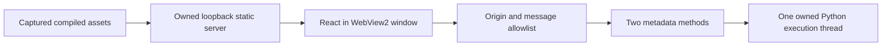

# Phase 4B.1 — Windows desktop shell and restricted metadata bridge

## Baseline and scope

Started from a clean `thesis/ui-demo` working tree at
`2f6e4576b4c5f3a948e5d157d368c9229e468e7d` in `D:\Final_Thesis_GitHub`.
AGENTS.md, Phase 4A/4A.1 reports, frontend routing/Vite/native contracts, and the
managed vault process/thread requirements were reviewed before implementation.
The inherited baselines were 1441 Python passes / 8 documented symlink skips and
80 browser passes. New regressions were written first: the missing desktop
module and missing Desktop Connected behavior failed before implementation.

This phase connects **application metadata only**. It does not create/unlock
vaults, prompt for passwords, load private keys, sign/verify PDFs, authenticate
accounts, implement a registry/database/API server or package an EXE. Existing
cryptographic modules, algorithms, signed bytes, formats, public return contracts
and benchmark datasets are unchanged. No commits, pushes or worktrees were made.

## Start the application

Use the existing Python 3.11 x64 environment. Desktop dependencies are already
installed in this workspace. For reproduction, install only the separate pins:

```powershell
Set-Location D:\Final_Thesis_GitHub
.\.venv\Scripts\python.exe -m pip install -r requirements-desktop.txt
Set-Location frontend
npm run build
Set-Location ..
.\.venv\Scripts\python.exe -m desktop.launcher
```

Run `npm ci` before building on a fresh frontend installation. The equivalent
launcher command in an activated environment is `python -m desktop.launcher`.
The dedicated window loads the production `frontend/dist/index.html`; no Vite
server is required. A missing/unsafe build produces a fixed npm-build instruction
before GUI startup. Missing prerequisites produce sanitized messages. There is
no URL argument, browser fallback, legacy-renderer fallback or runtime download.

The title is HybridSign — Desktop Preview, with the inherited `logobig.ico`
window icon where supported. Initial logical size is 1280×800, resizable, with
960×600 minimum dimensions. WinForms work-area bounds cap initial/minimum size
when the monitor cannot accommodate those dimensions. The five screens, relative
Vite asset base, hash navigation, themes, dialogs and keyboard behavior remain.

Browser development is unchanged:

```powershell
Set-Location D:\Final_Thesis_GitHub\frontend
npm run dev
```

## Architecture



`desktop.launcher` starts a worker, creates one pywebview window and supplies a
custom server class through pywebview's server hook. It binds only 127.0.0.1 on
an ephemeral port. The static server is owned and stopped by the launcher; it
has no application API routes or additional backend framework.

Startup registers an asset-server owner only after its execution thread starts.
Thread-start failure closes the bound socket; bind failure leaves no partial
owner. Nested launcher cleanup still stops the worker when static-server cleanup
raises. Three additional fault-injection regressions first demonstrated these
failure paths, then passed after the cleanup fix.

`capture_build()` captures immutable bytes once before startup. Only index.html,
optional mark.svg and approved compiled asset extensions under assets/ are
available. Symlinks/junctions, reparse assets, hard-linked files and excessive
file/total sizes are rejected. Requests are exact allowlist lookups, not path
joins. Root Python files, vaults, keys, QA files and directory listings are not
served. POST/unknown paths, traversal, hostile Host/Origin headers and query
variants are rejected. Idle connections have a timeout so shutdown can complete.

This uses the documented [pywebview server/window API](https://pywebview.flowrl.com/api/).
The default built-in server was not used because the pinned implementation also
registers an HTTP JS API callback route. This application needs only static bytes
and the native WebView2 channel, so that extra endpoint is absent.

## Public native contract

`window.pywebview.api` contains exactly:

| Method | Arguments | Public data |
| --- | --- | --- |
| `get_app_info()` | None | applicationName, applicationVersion, runtime, desktopStatus |
| `get_capabilities()` | None | nativeShell, vaultOperations, pdfSigning, pdfVerification, accountRegistry |

Success envelope:

```json
{
  "ok": true,
  "protocolVersion": 1,
  "data": {
    "applicationName": "HybridSign",
    "applicationVersion": "0.1.0",
    "runtime": "pywebview-edgechromium",
    "desktopStatus": "connected"
  }
}
```

Capabilities are exactly:

```json
{
  "nativeShell": true,
  "vaultOperations": false,
  "pdfSigning": false,
  "pdfVerification": false,
  "accountRegistry": false
}
```

Errors have `ok: false`, `protocolVersion: 1`, and a fixed `error.code/message`.
Codes are INVALID_REQUEST, UNAVAILABLE, BUSY, TIMEOUT and INTERNAL_ERROR. Extra
method arguments return a stable invalid-request error. Raw malformed/oversized,
untrusted-origin or unapproved transport messages are discarded before framework
dispatch. Exception text, paths, Python objects, worker references, keys,
passwords and handles are never metadata responses.

Python TypedDict definitions and separate TypeScript interfaces describe the
versioned JSON shapes. The existing future `NativeBridgeV1` operations remain
unimplemented; no createVault/signDocument/verifyDocument method is exposed.

## Frontend initialization and honest status

`connectDesktop()` listens for documented
[`pywebviewready`](https://pywebview.flowrl.com/api/#pywebviewready), checks for
already-created methods and validates both responses. It verifies protocol,
runtime, exact fields and capability values. Unexpected fields or feature flags,
malformed getters, exceptions and protocol mismatches produce browser Preview.
There is one initialization attempt, a maximum three-second deadline and abort/
listener/timer cleanup. Late replies cannot turn a timed-out attempt into success.

Browser mode displays UI PREVIEW and Native bridge unavailable. A successful
native metadata handshake displays Desktop Connected and Vault / PDF not
integrated. The About dialog explains that signing/verification/vault integration
is not ready. Desktop presence alone is not evidence of cryptographic capability,
identity, key ownership or authorization.

Actual Sign PDF / Verify PDF remain disabled. Vault actions are still clearly
labelled demo states. Privileged native requests still fail explicitly. Native
downloads are blocked by policy, and connected-mode JSON export controls are
disabled with an explanation. Browser JSON preview export remains compatible.
Even if the metadata handshake fails, native download restrictions remain active.

## Worker lifecycle and threading

`Worker` owns one non-daemon execution thread and a bounded FIFO queue (default
capacity 8). It accepts the `Command.STATUS` enum only, not caller-supplied
functions, string method names or arbitrary objects. Requests have bounded
deadlines; expired/cancelled queued work is not executed. Results are ordinary
non-sensitive status dictionaries. No key objects or vault handles are stored.

Lifecycle states are NEW, STARTING, RUNNING, STOPPING, STOPPED and FAILED.
Starting a running worker is idempotent; stopped workers cannot be reused.
Shutdown rejects new work, settles pending work, signals stop and joins the owned
thread. An already-running Python operation cannot be forcibly interrupted:
shutdown reports failure if its deadline is exceeded. Current status work is
short and bounded. Future vault I/O must provide cooperative cancellation and
bounded operations rather than pretending a timeout kills Python execution.

pywebview may invoke public methods from different threads. Both methods delegate
their status request to this same owner. WebView2/COM access stays in native GUI
handlers; bridge trust checks use the source recorded by those handlers. At
most eight bridge method executions are admitted concurrently. Framework
response-marshalling threads can outlive a method; this is not a complete
resource-exhaustion defense against compromised trusted frontend code.

`vault.py:_handle_binding()` requires the issuing process, issuing Thread object
and module context. Phase 4B.2 must issue/use/close managed handles entirely on
this worker and map opaque UI references to worker-owned sessions. It must never
serialize a handle or move a recovered key pair into a pywebview callback thread.

## Native security controls and assumptions

The pinned [WebView2 adapter](https://github.com/r0x0r/pywebview/blob/6.2.1/webview/platforms/edgechromium.py)
is guarded before first document navigation. The launcher rejects other renderer
initializations. It replaces the default native message/popup handlers, then:

- Allows main navigation only to the owned entry document, including hash routes.
- Blocks external/file/data/javascript navigation, frames and popups. There is
  no external-browser or same-window URL fallback.
- Allows only captured asset URLs and GET/HEAD resource requests.
- Cancels downloads, denies permissions and disables host objects, devtools,
  debug accelerators, default context menus and default script dialogs.
- Filters raw messages for trusted source, bounded JSON, exact approved method
  names, argument-list shape and constrained callback IDs. Dotted/private lookups
  and framework DOM/state/file-drop commands never reach the generic dispatcher.

The dedicated js_api object has only two public methods. This matters because
pywebview enumerates public callables, and the underlying generic dispatcher can
otherwise resolve nested attributes. Broad application objects are not exposed.
Hook setup failure leaves the bridge untrusted and closes the native window.

Static responses set no-store, nosniff, no-referrer, frame denial and a restrictive
CSP. `unsafe-eval` is needed by pywebview's generated API functions; inline styles
are needed by existing UI primitives. Frames, objects, form submission and
network connections are denied. These exceptions are not a claim of a strict
script sandbox. Loopback alone is not the trust boundary: the source/message,
asset and native navigation restrictions are necessary together.

The source tree, build process, installed packages, OS and local execution
environment are trusted. Snapshot checks do not cryptographically authenticate
assets or defeat a same-user attacker racing filesystem changes. Compromised
processes, malware, malicious replacement of trusted build assets, native
dependency vulnerabilities and exhaustive denial of service remain outside the
claimed protections. There is no trusted identity or production/FIPS/CMS/PAdES
compliance claim.

## Runtime prerequisites and dependency changes

Tested Python: **3.11.9 x64**, Windows kernel **10.0.26200**, WebView2 Evergreen
**156.0.4314.58**, .NET Framework registry version **4.8.09221** (Release 533509).
The preflight requires Windows x64/Python 3.11, the exact desktop package versions,
installed stable WebView2 Evergreen 111+ and .NET Framework 4.6.2+.
Current supported Windows/.NET/WebView2 updates are recommended; older permitted
versions have not all been tested. The Chromium feature floor follows the
[Tailwind 4 browser baseline](https://tailwindcss.com/docs/compatibility), rather
than pywebview's older renderer-only minimum. See also the official
[pywebview renderer requirements](https://pywebview.flowrl.com/guide/web_engine)
and [Python.NET runtime guidance](https://pythonnet.github.io/pythonnet/python.html).

Only necessary desktop packages were installed into the existing environment:

| Package | Observed version | Change |
| --- | --- | --- |
| pywebview | 6.2.1 | New direct pin |
| pythonnet | 3.2.1 | New Windows direct pin |
| clr_loader | 0.3.1 | New transitive dependency |
| bottle | 0.13.4 | New transitive dependency required by pywebview; its default server is not used |
| proxy_tools | 0.1.0 | New transitive dependency |
| typing_extensions / cffi | 4.16.0 / 2.1.1 | Already installed, unchanged |
| pqcrypto / PyNaCl / cryptography | 0.3.4 / 1.6.2 / 50.0.2 | Unchanged |

Pins live in `requirements-desktop.txt`; inherited `requirements.txt` and npm
dependency files are unchanged. No WebView2/.NET runtime, browser binary or
cryptographic package was installed/upgraded. Pillow 13.0.0 already present in
the inherited environment is used only by the test screenshot helper.

## Automated results and real native evidence

| Command | Result |
| --- | --- |
| `npm run typecheck` | Passed, exit 0 |
| `npm run build` | Passed, TypeScript plus Vite production build |
| `npm run test:e2e` | **102 passed (1.3m)**, 0 failed/skipped/xfails/xpasses |
| Root: `.\.venv\Scripts\python.exe -B -m pytest -q -p no:cacheprovider` | **1517 passed, 8 skipped in 75.23 s**; 0 failed/xfails/xpasses |
| Runtime/native follow-up after raising the feature floor | **7 passed in 6.65 s** |
| Startup/cleanup follow-up, including actual native GUI | **34 passed in 9.01 s** |
| `npm run dev -- --strictPort`, Edge smoke check | Five routes, UI PREVIEW and no page errors; owned dev server stopped afterwards |
| `.\.venv\Scripts\python.exe -m pip check` | No broken requirements |

The Python total includes all 1441 inherited passing tests and 76 new desktop
cases. Only the original eight Windows symlink-privilege skips remain. The
browser total preserves all 80 existing tests and adds 22 native-status/readiness
executions. Existing tests were not weakened, removed or marked expected-failure.
The real GUI integration test runs; it is not silently skipped when prerequisites
or an interactive Windows session are missing.

Python coverage includes protocol/response shapes, privacy, invalid requests,
worker ownership/order/start/stop/queue saturation/expiry/errors, build snapshots,
path/HTTP restrictions, idle-connection shutdown, pinned launcher options,
missing/malformed runtime checks and real WinForms/WebView2 startup.
Browser coverage adds readiness before/after the event, strict protocol/flags,
malformed/extra fields and getters, sanitized exceptions, hung-call deadlines,
navigation preservation, continued disabled crypto actions and disabled native
exports. Existing accessibility and viewport checks remain green.

The actual native subprocess probe verified:

1. A visible Windows window, production React UI and Desktop Connected.
2. Exactly two public methods and exact public metadata/capabilities.
3. All five hash routes and Light/Dark switching in WebView2.
4. Window resizing without horizontal content overflow.
5. Disabled real signing/verification, no password inputs, simulated vault state only.
6. Rejection of external/file/data navigation, popups and unapproved raw messages.
7. Clean exit code, stopped owned worker/asset threads and no vault/sign/verify/
   hybrid-key modules imported by the shell process.

[Native window screenshot](../frontend/qa/phase4b1/native-dashboard.png) and
[public native check results](../frontend/qa/phase4b1/native-checks.json) are saved.
The image was visually reviewed. It captures the owned window, not the entire
desktop. The runtime reported Window DeviceDpi 96; this is not a claim that
physical 125%/150% scaling or multiple monitors were validated.

The native test uses file-backed output because WebView2 descendants can inherit
standard handles; waiting for pipe EOF can outlive the Python GUI owner. The
probe remains bounded to 45 seconds and checks actual owned-thread shutdown.
Its subprocess is for test isolation only. The normal launcher does not spawn
another Python server/process; WebView2's necessary runtime processes still exist.

## Manual validation checklist and remaining limits

Automated real GUI checks and screenshot review were performed. A separate human
interaction session and multi-device validation were not performed. For review:

1. Run the documented launcher with no Vite server; confirm the dedicated titlebar,
   Desktop Connected, correct sidebar notice and unchanged five-screen layout.
2. Navigate via mouse and Tab/Enter; test dialogs/Escape, theme switching, resize
   and moving between monitors at 100%, 125% and 150% Windows scaling.
3. Confirm all real crypto/vault operations remain unavailable and demo labels
   remain visible. No password prompt or private-key upload should appear.
4. Close with the titlebar X/Alt+F4. Confirm the process exits and a fresh launch
   works. Repeat close during metadata initialization.
5. On a separate test setup with prerequisites absent, confirm the documented
   fixed startup messages and no browser/runtime-download fallback.

Privileged-operation integration, native password/save dialogs, managed session
ownership/cleanup, status health monitoring, cancellation of longer work and
native PDF rendering are future tasks. Browser mocks do not substitute for real
WebView2 tests; the current native adapter depends on pinned platform internals
and must be retested before any pywebview upgrade. Private profile cleanup is
owned by pywebview and can be affected by Windows file locks or antivirus.

## Phase 4B.2 integration tasks

Add independently reviewed fixed worker commands one at a time. Issue, use and
close managed vault handles on the same worker; map opaque references there.
Keep passwords/keys in native Python, validate cancellation/lifecycle/locking and
source/key/output protection, and reuse the existing transactional signer and
strict verifier unchanged. Extend the native message/response schemas and
capability flags only alongside tested implementations. Metadata connection or
demo-unlocked state must never grant signing authority. Identity, accounts,
registry/revocation, packaging and production compliance remain separate work.

## Exact changed-file manifest

| File | Change |
| --- | --- |
| `desktop/__init__.py` | New infrastructure-only package |
| `desktop/contracts.py` | Public versioned JSON schemas, constants and fixed errors |
| `desktop/worker.py` | Owned execution thread, bounded FIFO, fixed command and lifecycle |
| `desktop/bridge.py` | Dedicated two-method public bridge |
| `desktop/assets.py` | Immutable compiled assets and owned static-only server adapter |
| `desktop/security.py` | Pinned WebView2 navigation/resource/message guards |
| `desktop/runtime.py` | Read-only prerequisite checks and DPI/work-area fitting |
| `desktop/launcher.py` | Production native startup and cleanup |
| `requirements-desktop.txt` | Two direct desktop dependency pins |
| `frontend/src/native/desktop.ts` | Minimal metadata contract, readiness and strict validation |
| `frontend/src/native/status.tsx` | Shared runtime connection state |
| `frontend/src/native/contracts.ts` | Clarify that future privileged operations remain unimplemented |
| `frontend/src/main.tsx` | Install desktop-status provider |
| `frontend/src/App.tsx` | Accurate browser/native status without changing the approved layout |
| `frontend/src/components/VaultDialogs.tsx` | Distinguish connected shell from missing vault integration |
| `frontend/src/pages/SignDocument.tsx` | Explain/disable native JSON downloads; real signing remains disabled |
| `frontend/src/pages/VerifySignature.tsx` | Same export restriction; real verification remains disabled |
| `frontend/tests/native-bridge.spec.ts` | New metadata/readiness/failure compatibility regressions |
| `tests/test_desktop_worker.py` | New worker regressions |
| `tests/test_desktop_bridge.py` | New public API/privacy/error regressions |
| `tests/test_desktop_security.py` | New assets, transport, launcher and cleanup regressions |
| `tests/test_desktop_runtime.py` | New Windows prerequisite and native guard tests |
| `tests/test_desktop_native.py` | Real Windows GUI subprocess integration assertion |
| `tests/desktop_native_probe.py` | Isolated GUI driver/public evidence; never an exposed application API |
| `frontend/qa/phase4b1/native-dashboard.png` | New real native-window capture |
| `frontend/qa/phase4b1/native-checks.json` | New public native integration evidence |
| `frontend/qa/phase4a1/after/*.png` | All 40 existing QA captures regenerated with current browser status copy |
| `README.md`, `frontend/README.md` | Native startup, browser compatibility and current boundaries |
| `docs/phase4b1-native-bridge-regression.md` | This report |

Historical regression documents, original Python implementation/tests and
dependency profiles, frontend routing/Vite configuration, npm dependencies and
benchmark datasets were preserved.
