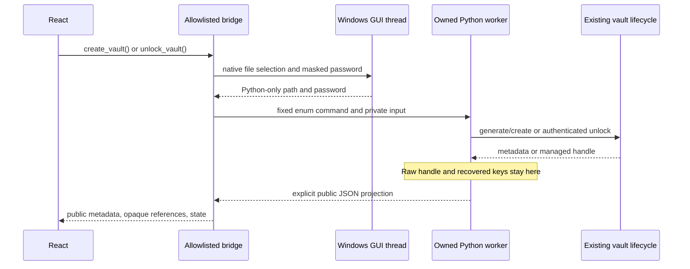

# Phase 4B.2A — real encrypted desktop vault integration

## Starting state and scope

Workspace `D:\Final_Thesis_GitHub`, branch `thesis/ui-demo`, initially clean at
`71285e9fd2fb2f622ca3cb2b74a0132fcdebf770`. Read AGENTS.md, all Phase 3 vault
records and format specification, Phase 4A/4A.1 records, Phase 4B.1 report, and
the existing generator, key representation, lifecycle, I/O and desktop code.

Baseline confirmed: **1517 Python passes / 8 Windows symlink skips**, and
**102 browser passes**. An initial concurrent baseline run had one WinError
10053 local HTTP connection abort in the existing static-server rejection test
(1516 passes / 1 failure / 8 skips). That test passed individually, then the full
unmodified Python baseline passed in **75.83 s**. The frontend baseline passed
in **2.7 min**. The abort is recorded rather than hidden by changing assertions,
increasing retries or accepting a different rejection result.

This phase implements local vault create, unlock, lock and authenticated public
metadata only. No cryptographic implementation, key ID, 2416-byte vault format,
PDF format/message, signer/verifier API, original dataset or dependency was
changed. No package installation, repository/worktree creation, commit or push
was performed. Password changes, backups/restores, PDF integration, accounts,
identity trust, FastAPI, PostgreSQL and EXE packaging remain out of scope.

## Run and use

The existing Python 3.11 x64 environment and Phase 4B.1 desktop dependencies are
used. From the repository root:

```powershell
Set-Location D:\Final_Thesis_GitHub\frontend
npm run build
Set-Location ..
.\.venv\Scripts\python.exe -m desktop.launcher
```

No Vite server is needed for the native application. For a fresh installation,
follow the existing Python/desktop and npm setup instructions in the READMEs.
Runtime prerequisites remain Windows x64, Python 3.11, pinned pywebview 6.2.1 /
pythonnet 3.2.1, WebView2 Evergreen 111+ and .NET Framework 4.6.2+.
Actual vault encryption still requires the existing cryptography 50.0.2 backend.

1. On **Key Vault**, choose **Create Vault**. The native Windows save picker
   selects an absent filename. Use an existing trusted folder on a fixed local
   NTFS volume; `.hvault` is the suggested extension. Enter and confirm a new
   password in the masked, Python-controlled Windows dialog. Creation requires
   15+ Unicode code points and at most 1024 strict UTF-8 bytes.
2. Creation generates one hybrid pair in memory and calls the existing
   `create_vault()`. The returned selection is **Locked**. A successful encrypted
   create does not implicitly retain an unlocked handle.
3. Choose **Unlock Vault**, select the encrypted file and enter its password in
   the native dialog. Only authenticated recovery confirms **Unlocked**. An
   authentication failure offers **Try Again** with a fresh native password
   prompt for the same validated selection; stale selections require reselection.
4. **Public key details** displays the exact public ID and both lowercase-hex
   public keys. This is not trusted identity enrollment.
5. **Lock Vault** invalidates the session and calls the existing `lock_vault()`.
   Closing the window also locks any active handle on its owning worker.
6. Reopen the application, choose Unlock Vault and select the same file. There
   is no persistent frontend path list or automatic directory/key discovery.

One selected vault per desktop window is supported. Lock before creating or
opening another. Native password change, backup and restore buttons are disabled.
PDF signing and verification are still unavailable; their separate DEMO / EXAMPLE
workflows do not consume the real vault session. Browser `npm run dev` remains
the simulated UI Preview and does not expose native vault operations.

## Architecture and ownership



`VaultWorker` extends the existing bounded worker rather than introducing a
second execution thread. It adds four fixed enum commands: VAULT_STATE,
VAULT_CREATE, VAULT_UNLOCK and VAULT_LOCK. Phase 4B.2A.1 adds private selection,
retry-check and selection-clear commands. No function/name supplied by JavaScript
can select arbitrary Python execution. The queue remains bounded to eight, with
worker request deadlines no longer than five seconds. Native prompts are
user-controlled and are outside that worker deadline.

`VaultService` is instantiated lazily **on the execution thread**. It owns the
sole managed handle and public selection. Generation, create, unlock, metadata
access, managed-provenance validation, encrypted snapshot/ACL/revision rechecks
and lock all run there. It reuses `generate_hybrid_key_pair()`, `create_vault()`,
`unlock_vault()` and `lock_vault()`. It does not implement a new codec or signer.

Paths and passwords enter a repr-redacted Python-only `VaultInput`. Queue payloads
are excluded from request repr; completion, expiry, rejection and shutdown release
references. A running timed-out request retains ownership of its input until it
finishes, avoiding caller-thread mutation of a live KDF input. Late unlocks are
locked instead of being presented as successful sessions. There is no automatic
retry or key-generation fallback.

The bridge serializes interactive operations with a fail-fast gate. Admission
stops immediately on close. Shutdown drains pending requests, clears their
inputs and locks active access on the owner thread before reporting stopped.
Cleanup errors are sanitized and cause shutdown failure rather than an uncaught
thread traceback or a claim of successful cleanup. Python/native work already
running cannot be forcibly killed by a timeout.

## Native bridge API and compatibility

The production `VaultBridge` exposes **exactly six public methods**:

| Method | JavaScript arguments | Behavior |
| --- | --- | --- |
| `get_app_info()` | None | Existing public metadata v1 envelope |
| `get_capabilities()` | None | Exact implemented/unsupported feature flags |
| `get_vault_state()` | None | Confirmed public state, opaque retry selection and operation progress |
| `create_vault()` | None | Native save picker/password confirmation, then create |
| `unlock_vault(selectionId?)` | None, or one 32-character lowercase-hex opaque selection ID | Native picker on new selection; retry revalidates the selection; always a fresh password prompt |
| `lock_vault(vaultId, sessionId)` | Exactly two 32-character lowercase-hex opaque IDs | Validate current session, then lock |

Paths, passwords, request dictionaries, keyword arguments and extra arguments
are not accepted from JavaScript for create/open/state. Unlock accepts only the
explicit optional opaque retry ID, never a path/password. Lock validates syntax
and checks both references against worker-owned state. Every authenticated
selection/unlock receives fresh unpredictable references. Locked, obsolete,
cross-worker/process and forged references cannot select managed material.

The successful operation envelope remains protocol v1:

```json
{"ok": true, "protocolVersion": 1, "data": {"vault": null, "cancelled": false, "selectionId": null, "operation": "idle"}}
```

With a selected vault, `vault` contains exactly:

| Field | Meaning |
| --- | --- |
| `vaultId` | Opaque selection reference, not the native handle or path |
| `sessionId` | Fresh opaque unlocked-session reference; null when locked |
| `displayName` | Selected filename stem, bounded to 80 characters |
| `state` | locked or unlocked |
| `hybridKeyId` | Unmodified hybrid-v1 identifier |
| `ed25519PublicKey` | Exact 32-byte public key, lowercase hex |
| `falconPublicKey` | Exact 897-byte public key, lowercase hex |
| `formatVersion` | 1 |
| `algorithms` | Ed25519 and Falcon-512 display names |

This is an explicit projection, never generic dataclass/object serialization.
No private seed, Falcon secret, password, KDF key, raw handle, mutex, worker
reference, native path or exception object is a response. Public keys are allowed
to reach React. Their ID and successful vault authentication do not establish
signer identity, key enrollment, authorization or revocation status.

Cancellation returns `cancelled: true` with unchanged public selection. The UI
does not display a success notification or replace state with a fabricated vault.
Errors use the existing fixed envelope with a stable allowlisted code/message;
the frontend maps codes to its own fixed feedback and never displays raw native
exception text. Unknown/malformed responses and throwing property getters fail
closed without exposing exception messages.

The native capability profile is exactly:

```json
{
  "nativeShell": true,
  "vaultOperations": true,
  "vaultCreate": true,
  "vaultUnlock": true,
  "vaultLock": true,
  "vaultPasswordChange": false,
  "vaultBackupRestore": false,
  "pdfSigning": false,
  "pdfVerification": false,
  "accountRegistry": false
}
```

Flags describe integrated code, not proof that a password, selected volume or
key identity is valid. Operations still validate their actual inputs/backend.
The frontend recognizes exactly the old two-method metadata-only profile and
this six-method vault profile; mixed/unknown shapes reject. Protocol version
and metadata envelopes remain v1. An old Phase 4B.1 frontend would safely reject
the expanded profile, so rebuild the bundled frontend with the new launcher.
The original `DesktopBridge` two-method foundation and its regressions remain.
The future `NativeBridgeV1` PDF/password-change/backup interfaces remain types
only; this phase has a separate explicit vault adapter.

## Native password dialog

`NativeDialogs` marshals work with WinForms `BeginInvoke` onto the window's GUI
thread. Neither the worker nor a pywebview callback thread constructs/shows GUI
controls directly. This follows the Windows Forms
[control-thread ownership rules](https://learn.microsoft.com/en-us/dotnet/desktop/winforms/controls/how-to-make-thread-safe-calls).
The existing pywebview window owns the dialogs; they are not HTML password forms.

Save/OpenFileDialog restrict selection to a single file, require existing parent
folders and restore the current directory. Save does not offer replacement as a
successful flow; the lifecycle enforces absent destination again. Password forms
are fixed modal WinForms dialogs with `UseSystemPasswordChar = True`, a creation
confirmation field, Enter/Cancel/Escape behavior and bounded text controls.
The existing `_encode_password()` policy is reused on both GUI validation and
worker/core validation. Unlock retains compatibility with existing short-password
codec inputs and does not impose the new-password minimum. Passwords are not
trimmed, normalized or case folded.

Controls and forms are disposed through finally blocks on success, cancellation
and ordinary errors. Password controls and selected-result references are cleared
when possible. Closing revokes new work and schedules cancellation of owned
native dialogs without blocking the GUI on a worker join. Passwords are never
arguments to a JavaScript method, an environment variable, URL, CLI argument,
application log or application storage.

These are ordinary local process dialogs, not a protected Windows secure desktop
or an anti-malware/anti-keylogger boundary. Plaintext exists in Python strings,
.NET controls/strings, encoded bytes and native cryptographic memory. Reference
release and locking do **not** guarantee zeroization, swap/dump exclusion or
revocation of material already copied by a compromised process.

## Filesystem, lifecycle and failure behavior

All existing lifecycle protections remain authoritative: fixed local Windows NTFS
with persistent ACL support; current-user ownership; the exact protected user /
LocalSystem DACL; rejection of reparse/symlink/junction components, hard links,
unsafe namespace/stream aliases and unsupported volumes; cooperative fail-fast
sidecar locking; bounded encrypted captures; revision/identity rechecks; encrypted
candidate fsync/close/authentication; and native create-only atomic publication.
There is no permission repair, elevated retry, copy/delete fallback or relaxed ACL.

Existing create destinations reject before generation in orchestration and again
at lifecycle publication. Failed unlock never calls the generator. Password or
file-dialog cancellation occurs before generation/lifecycle mutation. All actual
vault file writes remain ciphertext; persistent empty lock sidecars remain part
of the existing coordination design rather than being deleted as temporary files.

While unlocked, a state read validates managed provenance, cooperative access and
the captured encrypted revision. Observed changes or failures conservatively lock
the session and reject. Locked selections retain **last authenticated public
metadata**, labelled as such; they do not claim that a locked file was freshly
authenticated without its password. Frontend refresh occurs on connection,
operation completion, window focus and explicit Refresh status. Authentication
failure preserves confirmed locked metadata or shows No vault unlocked when none
has been authenticated. Connectivity, malformed-result and uncertain-operation
errors still fail closed to unknown/unconfirmed state. See the Phase 4B.2A.1
correction below for the current transitions and retry protocol.

| Scenario | Expected behavior |
| --- | --- |
| Wrong password / damaged ciphertext | Fixed rejection, file preserved, explicit retry only, no new keys |
| Dialog cancellation | No reported success or vault mutation |
| Existing create destination | Preserve destination; no generation/overwrite |
| Unsupported storage / ACL / access error | Fail closed; no fallback or permission change |
| Forged, locked or stale session IDs | Reject without granting managed access |
| Observed external vault change | Lock/invalidate active session and reject |
| Concurrent interactive operation | BUSY; no second prompt or generator |
| Close during generation before create | Stop before lifecycle publication; discard in-memory result |
| Close after unlock or while unlocked | Owner-thread lock and reference release |
| Worker deadline / uncertain I/O or post-commit error | No success reported; inspect selected location before retrying |
| Cleanup failure | Sanitized failure, no claim of erased memory or guaranteed cleanup |

An already-started create transaction cannot be rolled back just because a UI
deadline or window close occurred. A publication may complete before cancellation
is observed, or before a lock-release error. An existing destination will still
not be replaced. Do not automatically retry/regenerate/delete an uncertain result;
inspect/reopen it. Atomic visibility remains distinct from power-loss durability.
Existing cooperative locks/rechecks are not hostile-filesystem CAS or rollback
protection. Parent-directory ACL provisioning and cross-device permission migration
remain outside this phase.

## Frontend behavior and design preservation

The five-screen composition, shared styles, navigation, themes, responsive rules
and keyboard behavior are retained. Native Key Vault reuses the existing vault
card, management group, security panel and public-details modal. Dashboard uses
the same vault-summary layout with real public state and a LOCAL VAULT badge.
There is no initial fabricated personal vault in native mode. Unknown state is
explicitly Unknown rather than Empty or Locked.

React contains public metadata and opaque references only. No password input is
added to the DOM. Native create/unlock/lock confirmations originate in Python.
The sidebar, About and Settings accurately distinguish available vault operations
from missing PDF integration. Real native state and browser demo state use
separate providers and cannot authorize one another. Even an authenticated native
unlock does not enable Sign PDF or Verify PDF. The existing signing rehearsal is
still labelled DEMO and explicitly directs real vault operations to Key Vault.
Preview reset affects only demo state, not the real vault session or file.

## Test-first and native integration evidence

New tests preceded production behavior. The initial Python run failed to import
the absent vault bridge; the initial browser test remained UI PREVIEW with no
Create Vault action. Later red tests exposed close-during-generation publication,
unreported worker-finalizer failure, and malformed-host getter error leakage;
those paths were fixed without weakening assertions. A bounded Unicode-name
regression also aligned JavaScript's display-name length check with Python's
Unicode code-point bound. A real GUI test also caught
Python.NET's lack of constructor property-keyword support; controls now set their
properties explicitly and failed construction disposes the form.

Added **42 Python cases** and **20 browser executions**. The original 1517 Python
and 102 frontend purposes remain. The existing native shell test intentionally
now expects six exact allowlisted methods and the vault capability profile,
rather than two methods/all-vault-false. It still requires disabled PDF actions,
blocked untrusted navigation and clean owned-thread shutdown. Vault imports are
now legitimate; PDF signer/verifier imports remain prohibited in the shell probe.

Two separate real Windows application processes exercise:

1. Actual masked native password entry/confirmation and cancellation on the GUI
   thread, with no DOM password input.
2. Real Save/Open dialog opening and owned-window cancellation. Accepted file
   paths for the repeatable create/reopen flow use a **Python-only dialog seam**;
   actual human save/open acceptance remains a manual check.
3. Real native React Create → encrypted 2416-byte file → Locked state.
4. Wrong native password → no success, unchanged encrypted file, explicit retry.
5. Actual unlock → exact public ID/keys, then real UI Lock → stale-reference
   rejection → another native unlock.
6. Process shutdown while unlocked → actual `lock_vault()` on HybridSign-worker,
   then no owned worker/static-server threads remain.
7. Second process reopens the existing file with no generation and recovers both
   identical original public keys and ID; its shutdown also locks the handle.
8. Actual candidate-write instrumentation rejects raw/hex private values and
   password bytes. Bridge/public-state captures contain no secret or full path.

Credentials in this test harness travel through stdin memory into Python and
native controls, never argv/environment/JavaScript/logs or a plaintext fixture.
There is no production test/debug API. Disposable generated private values are
never committed. The QA JSON records public keys only.

Evidence under `frontend/qa/phase4b2a/`:

- [Native vault window](../frontend/qa/phase4b2a/native-vault.png)
- [Native dashboard](../frontend/qa/phase4b2a/native-dashboard.png)
- [Shell/navigation checks](../frontend/qa/phase4b2a/native-checks.json)
- [Creator-process checks](../frontend/qa/phase4b2a/vault-create-checks.json)
- [Reopener-process checks](../frontend/qa/phase4b2a/vault-reopen-checks.json)

Screenshots capture owned windows only. Historical Phase 4A/4A.1/4B.1 images are
preserved; regenerated unchanged-browser captures are not included as changes.

## Exact results

| Command / check | Result |
| --- | --- |
| Full Python suite, `python -B -m pytest -q -p no:cacheprovider` | **1559 passed, 8 skipped in 90.78 s**; 0 failed/xfails/xpasses |
| `npm run typecheck` | Passed separately, exit 0 |
| `npm run build` | Passed, exit 0; production bundle built |
| `npm run test:e2e` | **122 passed (1.5 min)**; 0 failed/skipped/xfails/xpasses |
| Native process/GUI follow-up, final capture | **1 passed in 15.98 s**, both actual application processes |
| `python -m pip check` | No broken requirements |

Only the existing eight `tests/test_signing_io.py:22` symlink-privilege skips
remain. No new skip, xfail or xpass was added. The full suite retains frozen
Phase 1 signatures, custom capacities, strict verification and transactional PDF
publication. All root cryptographic/vault modules and dependency profiles remain
unchanged. There is no claim of new PDF integration from those backend tests.

## Manual checks and remaining limitations

Automated real WinForms/WebView2 tests ran on the existing Windows x64 / Python
3.11.9 environment. There was no separate human interaction session, physical
multi-monitor/high-DPI test, malware assessment or cross-device validation.
For manual review:

1. Launch without Vite. Accept actual Windows Save/Open choices in a trusted
   local NTFS folder, create and reopen a disposable vault, and compare public ID.
2. Confirm creation confirmation, masked entry, Enter, Escape, titlebar Cancel,
   mismatch/length errors and focus return with keyboard/mouse and a screen reader.
3. Close/reopen while unlocked; confirm the file remains usable and starts with
   no unlocked session. Try explicit wrong-password retry and existing filename.
4. Test another monitor and 125%/150% Windows scaling. Browser viewport/DPR tests
   and the native runtime's reported DPI do not establish physical DPI behavior.
5. Try unsupported media, broader ACL copies or another Windows SID and confirm
   rejection without an automatic security downgrade.

Ordinary cancellation/error cleanup is tested; abrupt native/process termination,
Windows sharing/permission denial, hung filesystem/native calls and power loss
can prevent timely cleanup. No hard interruption of a running Python/native KDF
or I/O is promised. The pinned pywebview platform hooks need retesting on upgrades.
The inherited CSP exceptions (`unsafe-eval`, inline styles) and trusted-build /
trusted-local-process assumptions remain. A compromised frontend can request
native prompts; these dialogs are not a secure attention sequence.

Offline password guessing, weak user passwords, whole-vault substitution,
rollback, public-key linkability, OS paging/dumps, copied key references, local
malware/admin access and native-code defects remain risks. No recovery without
usable key material/password, trusted identity, compliance or production security
is claimed. No automatic idle lock, persistent inventory, cross-device migration,
password change, encrypted backup/restore, real PDF operation, backend/account
service or EXE packaging is implemented here.

## Exact changed-file manifest

| File | Change |
| --- | --- |
| `desktop/vault_worker.py` | New fixed-command vault worker and private, cleared request inputs |
| `desktop/vault_service.py` | New owner-thread handle/selection lifecycle and public projection |
| `desktop/vault_bridge.py` | New six-method allowlist, native orchestration and close admission gate |
| `desktop/dialogs.py` | New GUI-marshalled Windows file and masked password dialogs |
| `desktop/worker.py` | Private payload/dispatch/discard/finalizer hooks, cancellation and cleanup failure reporting |
| `desktop/contracts.py` | Vault profile flags, typed public metadata/result and fixed errors; expand transport allowlist |
| `desktop/launcher.py` | Wire vault worker/bridge/dialogs and shutdown locking |
| `frontend/src/native/desktop.ts` | Validate old metadata and new exact vault profiles |
| `frontend/src/native/vault.tsx` | New public-only adapter/provider, strict response/error handling and real state |
| `frontend/src/components/NativeVault.tsx` | New real vault card/summary/public-details UI using existing design |
| `frontend/src/components/ui.tsx` | Optional modal label; existing preview default preserved |
| `frontend/src/main.tsx` | Install native-vault provider |
| `frontend/src/pages/KeyVault.tsx` | Select real native component or unchanged demo workflow |
| `frontend/src/pages/Dashboard.tsx` | Select actual native vault summary in its existing position |
| `frontend/src/App.tsx` | Accurate vault/PDF status and current phase indicator |
| `frontend/src/components/VaultDialogs.tsx` | Accurate About text and explicit separation of signing demo from real vault |
| `frontend/src/pages/Settings.tsx` | Accurate native-mode version/limitations; preserve browser copy |
| `tests/test_desktop_vault.py` | 34 native orchestration, fault, lifecycle, session, privacy and concurrency cases |
| `tests/test_desktop_dialogs.py` | Seven exact password-policy and closed-dialog cases |
| `tests/test_desktop_vault_native.py` | Real two-process Windows GUI regression |
| `tests/desktop_vault_probe.py` | Private GUI test driver, write/privacy instrumentation and public evidence |
| `tests/test_desktop_native.py`, `tests/desktop_native_probe.py` | Intentional six-method/profile expectation; preserve shell restrictions and write current QA separately |
| `frontend/tests/native-vault.spec.ts` | 20 real-state contract/UI executions across both viewport projects |
| `frontend/qa/phase4b2a/native-dashboard.png`, `native-vault.png` | New native window captures |
| `frontend/qa/phase4b2a/native-checks.json`, `vault-create-checks.json`, `vault-reopen-checks.json` | New public evidence |
| `README.md`, `frontend/README.md` | Current startup, native-vault usage and scope |
| `docs/phase4b2a-real-vault-regression.md` | This report |

Existing `desktop/bridge.py`, asset server, navigation/security guards, runtime
requirements and all original crypto/PDF/vault code remain unchanged. The original
two metadata methods remain covered; the production bridge extends them explicitly.

## Phase 4B.2A.1 — authentication error UX and safe retry

This correction extends the uncommitted Phase 4B.2A work on `thesis/ui-demo`;
HEAD remains `71285e9`. The preceding step's verified baseline was 1559 Python
passes / 8 Windows symlink skips and 122 browser passes. Existing work was
preserved. No core crypto/vault module, signature API, encrypted format, dependency,
original dataset or Git history was changed, and no commit/push was made.

### Root causes

- `frontend/src/native/vault.tsx:NativeVaultProvider.run()` previously handled
  every failure by clearing metadata and setting `known = false`. A normal
  `vault.unlock` rejection therefore looked like lost native connectivity.
- `frontend/src/components/NativeVault.tsx:NativeKeyVault()` derived its loading
  heading from a generic busy flag. It could show Reading native vault state
  while the native password dialog was open, and had no contextual retry/dismiss.
- Successful native toasts were independent of the next operation. A still-visible
  Vault locked success could contradict a subsequent authentication error.
- `desktop/vault_bridge.py:VaultBridge._vault_reply()` selected a file for every
  unlock and had no worker-validated retry reference. The operation gate returned
  BUSY even for safe public progress reads, so React could not observe its phase.
- Refresh cleared the last error even when no new authentication was attempted,
  which could hide the error as the password dialog returned focus to the window.

### Corrected state transitions

Desktop connectivity remains owned by the existing metadata connection provider.
It is separate from the last authenticated vault, a pending file selection,
operation progress and the last operation error.

| Event | Authenticated vault metadata | Selection / operation / feedback |
| --- | --- | --- |
| New unlock | Preserve last confirmed locked state, or no metadata | Native file picker; no frontend path input |
| Password prompt | Unchanged; no unlocked session | Waiting for password; fresh masked native controls |
| Password submitted | Unchanged until Python confirms | Unlocking vault |
| Authentication rejection | Preserve confirmed locked state; otherwise No vault unlocked | One dismissible Couldn't unlock vault message; Try Again when a validated selection exists |
| Try Again | No new key metadata before authentication | Validate opaque reference and file snapshot, request a fresh native password; no file picker |
| Successful unlock | Python-confirmed original public keys, ID and fresh session | Vault unlocked; one appropriate success toast |
| File/password cancellation | Preserve the previous safe state | Stop busy/progress; no error or success toast |
| Selection changed, missing, expired or foreign | Do not grant access | Reject and offer Select vault again |
| Lock | Python-confirmed locked state, null session | Invalidate access and retry reference; retain appropriate lock feedback |
| Connectivity/invalid response/uncertain lock error | Fail closed to unconfirmed state | Separate sanitized error; no fabricated success |

The authentication message deliberately does not diagnose a password with
certainty:

> Couldn't unlock vault
>
> The password may be incorrect, or the vault could not be authenticated. Please try again.

No unauthenticated public header becomes trusted UI key metadata. A previous
locked card represents its labelled last authenticated metadata, not proof that
the pending selection is the same vault or has now authenticated.

Mutating vault actions clear prior native Vault created / Vault unlocked / Vault
locked success toasts. They do not clear unrelated notifications or browser-demo
feedback. Failed/cancelled operations never emit success. Passive focus/status
refresh preserves a contextual authentication error until dismissal or a new
explicit attempt. Late progress replies cannot overwrite a completed result or
the retry reference obtained after failure.

### Retry ownership, validation and API

The bridge still exposes exactly the same **six allowlisted method names**.
`unlock_vault()` remains valid. Its optional `unlock_vault(selectionId)` form
accepts exactly one 32-character lowercase-hex opaque reference, never a path,
password, object or arbitrary command. Unknown/consumed/cross-worker references
return fixed `STALE_SELECTION`; lock-session validation is unchanged.

`VaultService` captures an encrypted-only `VaultSnapshot` on the owning worker
after native file selection and before password entry. Only a fresh random
selection ID reaches React. The snapshot is **not** authenticated key material.
Private internal enum commands select, recheck or clear that pending selection;
none is exposed as a generic JavaScript dispatcher.

Retry validates the original checked path, supported volume, ACLs, file identity,
fingerprint and encrypted revision under cooperative locks before prompting.
The worker checks again before calling the existing `unlock_vault()`. It compares
the authenticated handle's captured fingerprint/revision with the selected
snapshot and rechecks that snapshot after recovery. A mismatch locks the new
handle and rejects. There is no key generation on any unlock or retry path.

Successful authentication consumes the retry reference. New selection, committed
creation, lock and worker shutdown invalidate it. A cancelled new password prompt
clears its new pending selection; cancelling a retry may retain the prior safe
encrypted selection for another explicit attempt. Neither case creates a session
or retains/reuses a password. Changed or unsafe selections are invalidated rather
than silently rebound to a different file.

Vault replies now include `selectionId` (nullable) and `operation` alongside
`vault` and `cancelled`. The phase is one of idle, reading-state, selecting-file,
waiting-password, unlocking, creating or locking. During an interactive operation,
`get_vault_state()` returns a locked copy of public, last-confirmed state plus
progress; it never accesses a managed handle from a bridge thread. Cached progress
is not a fresh cryptographic validation or a lifecycle lock on the file.

The frontend polls at most one progress request at a time while creating/unlocking,
with a two-second bound for status reads, and stops polling when the operation
settles/unmounts. Human-controlled native password dialogs have no artificial
JavaScript password timeout. Existing deadlines, shutdown behavior and limitations
of running native I/O remain unchanged.

The new adapter also recognizes the prior exact two-field vault reply. If no safe
reference is available, it offers explicit reselection. An older strict frontend
would reject the extended reply; rebuild `frontend/dist` with the current Python
shell. Protocol v1, six method names and capability flags remain unchanged. PDF
APIs, signed messages, algorithms and the 2416-byte encrypted format are unchanged.

### Tests and actual Windows evidence

New Python and browser tests preceded production changes and initially failed on
missing retry references and absent password-progress UI. Additional stale-selection
tests required an explicit reselection button. No test was skipped or marked xfail.
The earlier exact response assertion was updated to require both new public fields;
its six-method allowlist, capability and privacy assertions remain intact.

Added **11 Python cases** for original-key recovery via retry, no unauthenticated
metadata, cancellation, changed bytes/identity/missing files, forged/consumed and
cross-worker references, native ACL/volume rejection, and concurrent public
password/crypto progress reads. Added **14 browser executions** for contextual
errors, connected state, retained locked metadata, fresh-password opaque retry,
success-toast replacement, cancellation, dismissal/focus refresh and stale-reference
reselection and exact progress-field types. Existing backend/browser/demo security
assertions remain.

The real Windows GUI test now creates a disposable vault, unlocks and locks it,
tries a wrong password, inspects the error and prior locked state, retries through
the same native selection with a fresh password, and confirms the unchanged hybrid
ID. It verifies no file-picker call occurs for retry, cancels a subsequent native
password prompt, checks unchanged encrypted bytes and locked state, then unlocks
again. The second application process still recovers the same original keys.
Both processes lock access on worker shutdown. No supplied real-user credential
or existing user vault is needed for these tests.

Native controls remain masked, GUI-owned and initially empty on every prompt.
A test-only worker delay makes Unlocking vault observable on fast hardware; the
actual cryptographic recovery remains real. File-dialog acceptance still uses the
existing Python-only test seam; actual picker opening/cancellation is exercised.
These are automated visible WinForms/WebView2 tests, not a separate human session.

The following screenshots were captured from the owned native application window
and visually reviewed. The retry image shows the native dialog before any test
password is entered; no plaintext password or private key appears:

- [Wrong password, retained locked card and contextual retry](../frontend/qa/phase4b2a1/wrong-password.png)
- [Retry, fresh native password dialog and Waiting for password](../frontend/qa/phase4b2a1/retrying.png)
- [Successful unlock and the original hybrid ID](../frontend/qa/phase4b2a1/successful-unlock.png)

| Validation | Result |
| --- | --- |
| Full Python regression suite | **1570 passed, 8 skipped in 148.22 s**; 0 failed/xfails/xpasses |
| TypeScript check | Passed separately, exit 0 |
| Production build | Passed, exit 0 |
| Full browser suite | **136 passed (1.7 min)**; 0 failed/skipped/xfails/xpasses |
| Final actual Windows GUI / screenshot follow-up | **1 passed in 13.94 s**, creator and reopener processes |

The eight existing Windows symlink-privilege skips are unchanged. No packages,
cryptographic modules or benchmark inputs were changed. Existing frozen signatures,
custom capacities and both eleven-element signing/verification contracts still pass.

### Exact changes in this correction

This list is relative to the already-uncommitted Phase 4B.2A implementation above:

| File | Correction |
| --- | --- |
| `desktop/worker.py` | Three explicit private selection enum commands |
| `desktop/vault_worker.py` | Opaque selection input and fixed command admission |
| `desktop/vault_service.py` | Worker-owned encrypted retry snapshot, identity/revision checks and invalidation |
| `desktop/vault_bridge.py` | Optional opaque retry argument; native progress/public cache; cancellation cleanup |
| `desktop/contracts.py` | Typed public progress/selection fields and fixed stale-selection error |
| `frontend/src/native/vault.tsx` | Separate operation/error/selection state; authentication-specific preservation; bounded progress; toast cleanup |
| `frontend/src/components/NativeVault.tsx` | Contextual error, Try Again/reselect/dismiss, truthful empty/progress states |
| `tests/test_desktop_vault_auth_ux.py` | 11 new actual vault retry/security regressions |
| `tests/test_desktop_vault.py` | Require the exact extended public state response |
| `frontend/tests/vault-auth-ux.spec.ts` | 14 new browser executions |
| `tests/desktop_vault_probe.py`, `tests/test_desktop_vault_native.py` | Real visible wrong-password/retry/cancel sequence, fresh controls and original-ID checks |
| `frontend/qa/phase4b2a1/*.png` | The three individually linked screenshots |
| `frontend/qa/phase4b2a/` | Refreshed disposable public native evidence and current window captures |
| `docs/phase4b2a-real-vault-regression.md` | Current contract/behavior and this correction record |

### Remaining limitations

Retry state is process-local and bounded to one pending encrypted selection; it
is not persisted and does not survive closing the application. It is not an
identity assertion, unlocked-key capability or password cache. Public progress
describes the operation phase, not proof of authentication. The UI retains the
last confirmed locked metadata only where the failure contract makes that safe.

The existing same-user/malware, filesystem-race, cooperative-lock, rollback,
zeroization, offline-guessing and native-crash limitations remain. Neither the
fresh native prompt nor reference release protects against a compromised local
process. Native calls cannot be forcibly interrupted just because a UI deadline
elapsed. Human save/open acceptance, screen-reader use and physical high-DPI /
multi-monitor checks remain manual. No new compliance or production-security
claim, backend service or PDF integration was introduced.
