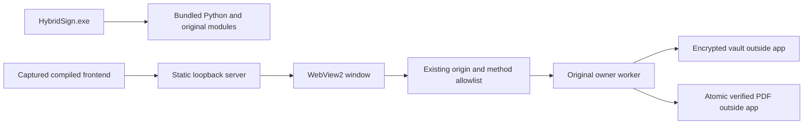

# Phase 4C.2A - Windows x64 portable packaging

## Baseline, scope and architecture

Started from clean `D:\Final_Thesis_GitHub`, `thesis/ui-demo`, HEAD
`8782ce71bf88aaaca1faffb88b91111aa648722d`. Read AGENTS.md, README, the Phase
4B native/vault/signing/verification records and Phase 4C.1 readiness report.
The inherited baseline is 1635 Python passes / eight symlink skips and 266
frontend passes. No commit, push, repository/worktree or installer is created.

The official entry point calls the existing launcher. PyInstaller embeds Python
3.11, the required application modules, metadata and native dependencies in a
**one-folder Windows GUI distribution**. The production React build and icon are
under `_internal/`. No Vite server, external Python or Node runtime is needed on
the target machine. WebView2 Evergreen and .NET Framework remain external.



The cryptographic implementation, signed bytes, PDF/vault formats, algorithms,
public APIs/11-element tuples, managed-handle ownership, bridge method list,
renderer restrictions, NTFS/ACL policy and publication transaction are unchanged.
The only new user-storage restriction applies to frozen native Save dialogs:
vault/PDF output inside the application folder is rejected before acceptance.

## Build requirements and commands

Observed build host: Windows 11 Pro x64, kernel **10.0.26200**, Python **3.11.9**.
Native acceptance uses WebView2 **157.0.4341.46** and .NET Framework **4.8.09221**
(Release **533509**). Older permitted runtime floors are not all tested.

PyInstaller was absent at preflight. Only these five necessary build tools were
installed: PyInstaller **6.22.3**, hooks-contrib **2026.10**, altgraph **0.17.5**,
pefile **2024.8.26**, pywin32-ctypes **0.2.3**. Existing packaging **26.3** and
setuptools **65.5.0** remain build prerequisites. Cryptographic packages were not
upgraded. `requirements-packaging.txt` records the build profile;
`requirements-portable.txt` records the minimal observed runtime closure for a
new build environment. The inherited requirements files are not rewritten.

Runtime pins: pywebview 6.2.1, pythonnet 3.2.1, clr_loader 0.3.1, pqcrypto 0.3.4,
PyNaCl 1.6.2, cryptography 50.0.2, cffi 2.1.1, pycparser 3.12, bottle 0.13.4,
proxy_tools 0.1.0 and typing_extensions 4.16.0. Argon2id remains the existing
cryptography backend; no separate argon2-cffi dependency is introduced.

On this existing environment, from PowerShell:

```powershell
Set-Location D:\Final_Thesis_GitHub
# Already performed here; needed only if the documented packaging tools are absent:
.\.venv\Scripts\python.exe -m pip install -r requirements-packaging.txt
# Requires the existing npm dependencies; npm ci is for a fresh frontend checkout.
powershell -NoProfile -ExecutionPolicy Bypass -File packaging\build-portable.ps1 `
  -DistPath dist\portable -WorkPath build\portable
.\.venv\Scripts\python.exe -B packaging\zip-portable.py dist\portable\HybridSign
```

The build script resolves paths from its own location, checks pinned runtime/
tool versions, runs TypeScript + Vite, builds the spec, adds the available
third-party notices and writes external release hashes. ExecutionPolicy Bypass
is process-local, not a persistent machine-policy change. The script never
elevates, installs tools/runtimes or downloads a renderer. Choose a **fresh**
`-DistPath` on a subsequent build: an existing `HybridSign` folder is rejected,
not deleted. Omitting `-DistPath` uses `dist/HybridSign` on a fresh build.

For a new build host only, prepare Python 3.11 x64 and install both pinned
requirements profiles into its new environment, then `npm ci` from the lockfile.
Do not recreate/upgrade a working environment merely to package it. The current
host build is validated; fresh-host dependency availability and byte-identical
rebuilds have not been independently reproduced. Tool/dependency pins and hashes
support traceability, not a promise of deterministic PE timestamps or native builds.

## Resource resolution and native components

`desktop.runtime.resource_root()` uses the source module root normally and
PyInstaller's explicit absolute `sys._MEIPASS` in frozen execution, following its
[runtime documentation](https://pyinstaller.org/en/v6.22.3/runtime-information.html). An invalid
bundle root raises; there is no cwd/source-tree fallback. The launcher uses this
root for both `frontend/dist` and `logobig.ico`.

`capture_build()` still checks original ancestors and files for reparse points,
symlinks/junctions, hard links, sizes and allowed extensions before capturing
immutable bytes. The custom server still serves exact allowlist entries only.
Its origin, method, Host/CSP and native transport restrictions are not relaxed.
Source and frozen launches both use `gui="edgechromium"`, never a browser or
another GUI renderer. No debugging port or packaged test-control channel exists.

The spec preserves pywebview/pythonnet distribution metadata for the existing
exact version checks, plus observed runtime metadata/licenses. It includes:

- Python 3.11 x64 runtime and required standard-library extensions.
- `pqcrypto._sign.falcon_512` CFFI extension and PyNaCl/libsodium binding.
- cryptography's Rust/native binding and dynamic Argon2id/AES-GCM imports.
- pythonnet `Python.Runtime.dll`, `clr_loader` amd64 `ClrLoader.dll`.
- Microsoft WebView2 Core/WinForms assemblies and **win-x64** WebView2Loader.dll.
- pywebview's JavaScript support, production Vite assets, fonts, mark and icon.

An initial EXE failed closed. A separate, local diagnostic build traced the
failure to pywebview 6.2.1 enumerating all three architecture **directories** in
`interop_dll_path()`, even on x64. Two documented directory-marker files retain
the win-x86/win-arm64 paths without shipping unused architecture DLLs or changing
the pinned adapter. That diagnostic build is not the release or acceptance EXE.

Unused Qt/PySide/GTK/Cocoa/CEF/MSHTML/Android backends, Streamlit, pytest,
PyInstaller tools, setuptools/distutils/pkg_resources and unused CFFI compiler
helpers are excluded. Runtime cryptographic bindings remain the original
precompiled implementations. No compiler, Node/npm/node_modules, tests, QA,
benchmark datasets, user documents, private keys or vaults are included.

## Startup and storage failure handling

Windowless startup errors use a fixed native error dialog. Missing/unsafe bundled
assets or package metadata instruct the user to extract the complete trusted
portable folder. Missing .NET/WebView2 produces the existing explicit prerequisite
message. Unexpected exceptions use a sanitized message, without a traceback or
private diagnostics. Source execution keeps stderr behavior. There is no
automatic download, installation, ACL repair, browser fallback or elevation.

A missing Python DLL can fail in the PyInstaller/Windows bootloader before Python
can show an application-level message; this remains an external integrity failure.
The complete folder, not the EXE alone, is the supported distribution.

Frozen native Save callbacks reject destinations resolving beneath the executable
directory, with a fixed explanation and a still-open chooser. Creation/password
submission or signing does not start for that rejected selection. This is an
additional accident-prevention boundary, not a replacement for existing path,
alias, cooperative locking, ACL, snapshot and final-publication checks. Same-user
malware and hostile filesystem replacement races are not solved by a dialog check.
WebView2's private profile/temp behavior remains owned by the pinned framework;
the app adds no secret file, application-directory log or persistent unlocked state.

## Public PDF attributes

`.gitattributes` now marks `*.pdf binary`. The tracked public fixture was already
intact: **742 bytes**, SHA-256
`2d94ba434bbbfda3ffcd78731f2e94146352e5dc7680dcd566d2ca0614a20639`.
It was not regenerated or stripped. Its intentional xref trailing spaces remain.
The existing fixture-integrity test validates stream length and all object/xref
offsets. New tests check Git's clean filter and a clean checkout using a separate
temporary index, without changing the real index, history or creating a repository.
The checkout retains exact bytes and the `startxref` offset **559**.

## Packaged EXE acceptance

`tests/portable_probe.py` is an **external** Windows UI Automation driver, never
bundled. It drives the real copied `HybridSign.exe` with native mouse/keyboard
input and actual Open/Save/masked password controls. It does not import the app
inside a source Python process, substitute accepted paths, inject JavaScript,
enable CDP or expose a test API. Its Python/.NET dependencies are test tools only.

The complete release is copied outside the repository to an ordinary folder
under `D:\HybridSign Portable QA`, containing spaces and Vietnamese characters.
Application and document folders are separate. The EXE runs with an unrelated
cwd and a minimal Windows-only PATH, no PYTHONHOME/PYTHONPATH/VIRTUAL_ENV. Its
original vault password is random, local to the driver process, entered only in
the masked native controls and retained only in memory across the two EXE runs.
No password is written in argv, environment, reports or frontend data.

Recorded workflow:

1. Start connected with no unlocked vault; inspect five screens, both themes and
   default/maximized/restored/minimum windows and sidebar Auto/navigation/Pin.
2. Reject a new vault destination inside the application folder, then create and
   unlock an encrypted vault in the separate trusted local NTFS work directory.
3. Record its exact full public Hybrid Key ID; sign the public PDF through the
   existing worker and original self-verifying atomic signer.
4. Reject an application-folder PDF destination. Refuse normal Close while the
   signing operation is reserved and awaiting native Save; continue that same job.
5. Confirm the real saved PDF, completed self-verification and **HYBRID VALID**.
6. Change a separate signed copy (`APPROVED` to `REJECTED`, same byte length),
   keep the original and selected keys, and confirm **HYBRID INVALID**.
7. Lock; confirm public-snapshot verification still yields VALID.
8. Explicitly create a separate wrong-key negative fixture through the EXE;
   verify the original PDF with that pair and confirm INVALID. This is not a
   recovery fallback or replacement for the original signing pair.
9. Lock and close normally. Start the same copied EXE in a second process,
   confirm no automatic unlock, unlock the original vault and compare the exact
   same ID. Sign and verify again, then close normally.

The 742-byte source stays unchanged; default signatures produce a 5368-byte
signed output and 2416-byte encrypted vault. UIA tests require an unlocked
interactive desktop and the tested English native dialogs. Driver development
exposed accessibility-tree/render races, physical/logical DPI coordinate
differences and native filename-commit behavior; these were corrected in test
automation, without weakening application security or replacing real pickers.

The final smaller release completes this workflow in two real EXE processes.
It also tests exact full-ID clipboard contents, the manual/Auto indicator and
rapid duplicate signing admission while the Save dialog is active. Reading the
original encrypted vault's public metadata without any password yields VALID
with an explicit UNAUTHENTICATED label. Normal Windows Shell Open also succeeds
from a separately extracted ZIP with the application folder as cwd.

The process-module inventory confirms Python, Falcon, libsodium and cryptography
load from the copied `_internal/` folder, with no source-repository/.venv DLLs.
The three native cryptographic binaries are byte-identical to their installed
originals. The application folder's complete file inventory/hashes are unchanged
after the graphical workflow, including the two rejected Save destinations.

Three separate incomplete/altered bundle copies demonstrate native startup
failure for missing frontend assets, missing pywebview metadata and an incorrect
metadata version. Each shows a sanitized native message, no application window
or fallback, and exits **1 as expected** after acknowledgement. No .NET/WebView2
installation was removed or registry check bypassed for these tests.

Evidence:

- [Complete copied-EXE checkpoints and loaded components](../frontend/qa/phase4c2a/packaged-checks.json)
- [EXE/cryptographic-binary validation](../frontend/qa/phase4c2a/binary-checks.json)
- [Startup negative cases](../frontend/qa/phase4c2a/startup-checks.json)
- [Extracted-ZIP Shell Open](../frontend/qa/phase4c2a/shell-checks.json)
- [Generated vault](../frontend/qa/phase4c2a/packaged-unlocked.png)
- [Actual signed output](../frontend/qa/phase4c2a/packaged-signed.png)
- [VALID](../frontend/qa/phase4c2a/packaged-valid.png) / [tampered INVALID](../frontend/qa/phase4c2a/packaged-tampered.png) / [wrong-key INVALID](../frontend/qa/phase4c2a/packaged-wrong-keys.png)
- [Reopening starts locked](../frontend/qa/phase4c2a/packaged-restart-locked.png) / [verification after reopening](../frontend/qa/phase4c2a/packaged-reopened-valid.png)
- [Minimum window/sidebar](../frontend/qa/phase4c2a/packaged-sidebar-minimum.png) / [dark theme](../frontend/qa/phase4c2a/packaged-dark-dashboard.png)
- [Missing-metadata native error](../frontend/qa/phase4c2a/startup-metadata.png)

No encrypted vault, password, private key or signed user document is tracked.
The temporary test-index checkout affects no real index/history. Inherited
source GUI tests and their assertions are unchanged; historical QA captures
regenerated by those suites are restored, not included as new-phase changes.

To repeat external acceptance, use a **new empty work folder**, a complete copy
of the release outside the repository, and the existing development test tools:

```powershell
.\.venv\Scripts\python.exe -B tests\portable_probe.py `
  'D:\HybridSign Review\HybridSign' 'D:\HybridSign Review\Fresh test documents' `
  'frontend\qa\phase4c2a' 'demo_assets\sample-unsigned.pdf'
.\.venv\Scripts\python.exe -B tests\portable_startup_probe.py `
  'dist\portable\HybridSign' 'D:\HybridSign Review\Fresh negative tests' `
  'frontend\qa\phase4c2a'
.\.venv\Scripts\python.exe -B tests\portable_shell_probe.py `
  'D:\HybridSign Review\HybridSign' 'frontend\qa\phase4c2a'
```

The startup probe's parent workspace must exist; it creates fresh named copies.
The Shell probe uses the normal `open` verb without arguments or elevation.
These scripts are not dependencies for ordinary end-user launch.

## Release contents, hashes and regression results

Use **`dist/portable/HybridSign/HybridSign.exe`** with its complete folder, or
extract **`dist/portable/HybridSign-Phase4C2A-win-x64-portable.zip`** completely.
Earlier development/diagnostic outputs remain local and are not the release.

| Artifact | Exact size / inventory |
| --- | --- |
| `dist/portable/HybridSign/` | **138 files, 33,970,399 bytes** (32.40 MiB) |
| `HybridSign.exe` | Windows AMD64 GUI subsystem, original icon, `asInvoker` manifest |
| Portable ZIP | **14,912,004 bytes** (14.22 MiB), **140 file entries**, CRC test passed |
| ZIP extraction | All **138** application files match the release manifest; normal Shell Open passes |
| Native cryptographic binaries | **3/3** match original installed bytes |
| Original benchmark dataset hashes | **15 matched, 0 changed, 0 missing** |

EXE SHA-256:

```text
1fa00d14171336bfcd8a16aabff776e3905946f5bb15bb6f389cd81c1322bfdc
```

ZIP SHA-256:

```text
6f6364e0c53921aa0370e75def1b07e4e36d0b52739563058d778db3c447a293
```

Full release file inventory, individual byte counts and SHA-256 values are in
`dist/portable/HybridSign.manifest.json` and `HybridSign.sha256`, also included
beside the application folder in the ZIP. Source-side copies are retained as
[release manifest](../frontend/qa/phase4c2a/release-manifest.json) and
[per-file hashes](../frontend/qa/phase4c2a/release-checksums.sha256).
Checksums identify this local build, not its publisher. No compiled binary or
release ZIP is tracked or committed.

| Final check | Result |
| --- | --- |
| Full Python `.venv\Scripts\python.exe -B -m pytest -q -p no:cacheprovider` | **1661 passed, 8 skipped in 231.63s**; 0 failed/xfails/xpasses |
| Full Playwright `npm run test:e2e` | **266 passed (3.8m)**; direct runner exit 0, 0 failed/skipped |
| `npm run typecheck` | Passed, exit 0 |
| Production build, invoked by portable builder | Passed, TypeScript + Vite (**428ms** Vite build) |
| Official portable build | Passed, exit 0; pinned tool/runtime preflight and inventory validation |
| New packaging pytest cases (included in full total) | **26 passed** |
| Copied final EXE workflow | **1 complete two-process workflow passed**, 25 recorded checkpoints |
| Frozen startup fault copies | **3 passed**; each expected exit 1, no unexpected failure |
| Normal Shell Open | Copied folder and extracted ZIP passed; one native window, locked startup, exit 0 |
| Isolated inherited native follow-up | **2 passed in 52.18s** |

The eight skips are the inherited Windows symlink-privilege/Developer Mode
cases. No new skips, xfails or weakened assertions were introduced. The first
full run, concurrent with Playwright, reported **1659 passed, 2 failed, 8
skipped**: an inherited sidebar pointer wait failed and an inherited signing
GUI process timed out. Both passed in the isolated follow-up, followed by the
full serialized green run above, with no changes to inherited tests or production
behavior to suppress those failures. Their exact scheduling/focus cause is not
established. Run native GUI validation without competing UI automation/input;
this is not a claim of exhaustive unattended/stress reliability.

Before production changes, the new resource/error/attribute tests reported
10 failures / 1 pass; the additional frozen destination guard cases reported
5 failures / 14 passes. The final 26 cases cover these defects, clean Git
checkout, release-content exclusions and preservation of existing build output.
Source and installed-package audits confirm **only three production Python
files changed**, no frontend source changes, **no existing package upgrades**
and only the five necessary packaging-tool additions.

## Changed-file manifest

| File | Change |
| --- | --- |
| `.gitattributes` | PDF binary macro; preserve original bytes/trailing xref spaces |
| `.gitignore` | Narrow exception for `packaging/HybridSign.spec` only |
| `README.md` | Portable launch/prerequisite/build/report guidance; keep legacy source setup |
| `desktop/runtime.py` | `resource_root`, `report_startup_error`, `validate_user_destination`; frozen metadata error wording, same version/runtime checks |
| `desktop/launcher.py` | `default_build_path`/`launch` resolve frontend/icon from explicit root; `main` reports sanitized native startup errors |
| `desktop/dialogs.py` | `_allow_user_output` and native Save `FileOk` checks, frozen installation-folder write veto |
| `requirements-packaging.txt` | Pinned necessary build tools |
| `requirements-portable.txt` | Observed minimal runtime closure for a new build host |
| `packaging/HybridSign.spec` | Official x64 windowless one-folder build, explicit assets/metadata/imports/exclusions/icon |
| `packaging/entrypoint.py` | Thin call to existing launcher, no test/debug mode or CLI secrets |
| `packaging/hooks/hook-webview.py` | Required JS and x64 WebView2 components only |
| `packaging/hooks/hook-clr_loader.py` | Required amd64 NetFX loader only |
| `packaging/platform-directory.txt` | Marker for pinned adapter's unused architecture directory enumeration |
| `packaging/preflight.py` | Read-only architecture/version/icon build checks |
| `packaging/build-portable.ps1` | Reproducible production build; refuse existing releases, no delete/elevate/install |
| `packaging/release_manifest.py` | Required runtime/resource inventory, excluded-data checks and per-file checksums |
| `packaging/notices.py` | Available Python/runtime/npm license texts; no node_modules/source copying |
| `packaging/PORTABLE-README.txt` | End-user extraction, launch, prerequisites, storage and research limitations |
| `packaging/zip-portable.py` | Exclusive new ZIP from validated inventory, CRC and archive checksum |
| `tests/test_desktop_packaging.py` | 26 resource/error/metadata/Git/storage/release regressions |
| `tests/portable_probe.py` | External real copied-EXE UI automation and loaded-native-library evidence |
| `tests/portable_startup_probe.py` | Three actual frozen-bundle negative copies |
| `tests/portable_shell_probe.py` | Normal Windows Shell Open with app-directory cwd and clean shutdown |
| `docs/phase4c2a-portable-packaging.md` | This technical report |
| `frontend/qa/phase4c2a/` | Public screenshots, checks, source/package audit, release and capture manifests |

The [QA capture manifest](../frontend/qa/phase4c2a/capture-manifest.json) enumerates
every individual evidence file, size and hash (excluding itself). Cryptographic,
vault, signing/verification/worker/security modules and original fixtures/datasets
are unchanged. None of the superseded build artifacts or disposable local vaults
are part of the source change manifest.

## Limits and Phase 4C.2B recommendations

- No clean Windows VM is available. A copied development-machine EXE is not
  evidence that a fresh target has every external runtime/VC component installed.
- Missing prerequisite registry branches and exact metadata checks have unit
  fault coverage. Do not claim actual .NET/WebView2 uninstall/absence was tested
  on this host; no registry, ACL or runtime installation was modified for testing.
- Human Explorer/keyboard/screen-reader, localized dialogs, mixed-DPI/projector,
  downloaded ZIP/Mark-of-the-Web, Defender/SmartScreen, blocked folders and older
  supported .NET/WebView2 releases need separate acceptance.
- This EXE is unsigned. Checksums detect changes but do not authenticate a
  publisher or replace Authenticode signing. Available third-party license texts
  are included; completeness/redistribution terms need review before publication.
- Private keys/passwords remain Python/.NET/native memory; no guaranteed
  zeroization or malware resistance. Cooperative locks/ACLs are not protection
  from all same-user attacks, rollback or filesystem races. Atomic replacement
  is not power-loss durability; forced termination can leave PDF/profile temps.
- Mathematical validity does not establish signer identity, authorization at a
  trusted time or a timestamp. The format is custom, without CMS/PAdES/FIPS or
  general PDF-reader signature-panel compliance claims. Falcon lineage remains
  the evidence in `falcon-implementation-provenance.md`, not an assumed v1.2 label.
- Phase 4C.2B should validate a clean VM matrix and downloaded archive, review
  license notices and reproducible build inputs, then separately approve code
  signing/installer work. Single-file packaging, auto-updates, backend/accounts,
  recovery and trusted identity remain outside this phase.
