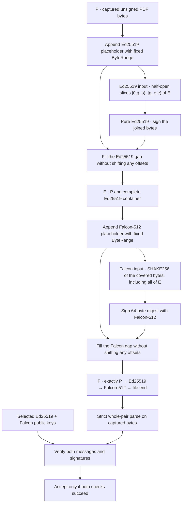

# Phase 5.1 — HybridSign implementation evidence

Evidence is scoped to `1c95c77` and the unchanged HybridSign 0.1.0
application. The source is the authority for signed bytes and acceptance rules.
The [research audit](phase5-1-research-audit.md) records the build lineage and
test run. The [traceability matrix](phase5-1-thesis-traceability.md) records
what each result can support.

## PDF preparation and signed revisions

The Windows desktop uses `desktop/pdf_io.py::locked_pdf()` and
`desktop/signing_service.py::SigningService.select()` to read a checked
local NTFS path and record a file fingerprint and SHA-256 snapshot digest.
The unsigned input must have a supported PDF header, a terminal
`startxref`/`%%EOF` pattern, a `.pdf` extension, at most 50 MiB
(52,428,800 bytes) and no reserved signature marker names. This checks a PDF
envelope. It does not parse the xref or establish that arbitrary PDF objects
render safely. The desktop signing service revalidates the selected revision
and output approval. The core captures the source via
`signing_io.capture_source()` and signs that snapshot. The legacy Python
signer shares the snapshot and marker checks but does not apply the desktop
envelope or size policy.
[Desktop PDF guard](../desktop/pdf_io.py#L35) · [Desktop signing service](../desktop/signing_service.py) ·
[Snapshot and alias guards](../signing_io.py#L40) · [Signing entry points](../sign.py)

Let `P` be the exact captured input. A signature container `C_i` consists of
the following byte segments.

```text
C_i = Start_i || ByteRange_i || Gap_i || End_i
Gap_i = "SigLength: " || ten decimal digits || LF
     || "Contents: <" || lowercase hex signature || ASCII zero fill || ">" || LF

E = P || C_E                   completed Ed25519 revision
F = E || C_F                   completed hybrid file
```

`Start_i` and `End_i` are exact ASCII lines including LF. The four marker
names are `%%ED25519_PQ_SIG_START`, `%%ED25519_PQ_SIG_END`,
`%%FALCON_PQ_SIG_START` and `%%FALCON_PQ_SIG_END`. Their bare names are
reserved throughout the file. The writer appends at deterministic offsets and
never replaces placeholder-like text in `P`. `ByteRange` encodes four
unsigned ten-digit decimal fields. For each stage, let `g_s` be the first
byte of its `SigLength` line, `g_e` the first byte of its end marker, and
`e` the exclusive end of its container. The tuple is
`(0, g_s, g_e, e - g_e)`. Thus the covered intervals are `[0, g_s)` and
`[g_e, e)`. The entire gap `[g_s, g_e)` is omitted from that layer's own
message. Both marker lines and the ByteRange line are covered.
[Format constants](../utils.py#L9) · [Offset construction](../utils.py#L223) ·
[Interval checks](../utils.py#L102)



1. **Ed25519.** `utils.compute_sha512_digest_for_byte_range()` joins
   the covered slices. Despite its inherited name, it performs no
   application-level SHA-512 call. `sign._sign_captured()` calls PyNaCl
   `SigningKey.sign(joined_bytes).signature`. This is pure Ed25519 over the
   selected bytes with Ed25519's internal hashing. Verification uses
   `VerifyKey.verify(joined_bytes, signature)`.
2. **Embedding.** The prepared gap uses a capacity field expressed in
   bytes and an all-zero hex buffer. In the completed state `SigLength`
   counts the **hexadecimal characters** of the detached signature, so
   64 Ed25519 bytes are encoded as 128 characters. Remaining capacity is
   filled with ASCII `0`. The writer checks fit and reparses the gap after
   replacing it at the known offsets. Content before and after the gap and
   the original ByteRange offsets are preserved.
3. **Falcon-512.** The complete Ed25519 revision is the prefix of the new
   state. `utils.compute_shake256_digest_for_byte_range()` computes
   `SHAKE256(F[0:g_s] || F[g_e:e] || F[e:]).digest(64)`. The helper
   explicitly appends a suffix term. It is empty in the writer and in every
   accepted final pair because `e = len(F)`. `falcon_512.sign(sk, digest)`
   receives these 64 bytes. Its native hash-to-point and randomness are
   internal to the Falcon implementation. The finished Falcon gap replaces
   the placeholder without changing the message or length.

The current writer reserves 128 bytes for Ed25519 and 2,048 bytes for
Falcon before hex encoding. Hence the default file growth is
`(138 + 2×128) + (136 + 2×2048) = 4,626 bytes`. The fixed terms are the
marker and field syntax lengths. This is deterministic for the default
writer regardless of Falcon's variable detached signature size. The
742-byte demo becoming 5,368 bytes corroborates the layout. Other validated
capacities change growth but keep the same signed-message construction.
The fixed overhead is a code/format result. It does not stand in for
measurements of latency, memory or compressed Falcon lengths.
[Signer](../sign.py#L74) · [Message functions and embedding](../utils.py#L267) ·
[Compatibility tests](../tests/test_completed_signatures.py#L259) · [Demo evidence](phase4c3-final-release-review.md)

### Publication and verification

`sign.sign_with_key_material()` and the legacy file-key adapter use the
same transaction and signer. `SigningTransaction.write_candidate()` stages
the final bytes in the destination directory, flushes, fsyncs and closes the
candidate. Verification of that candidate must start with the literal
Boolean `True`. The core rechecks path/fingerprint guards before the single
`os.replace()` publication. The desktop service verifies the saved bytes
again before reporting completion. There is no claim of power-loss
durability, crash-proof cleanup or immunity to hostile filesystem races.
[Transaction](../signing_io.py#L114) · [Managed vault signing](../vault_signing.py#L61) ·
[Publication regression](phase2b4b2-regression.md)

`verify._verify_document()` starts with `utils.parse_signature_pair()`,
which enforces exactly one of each reserved marker at its canonical location,
one completed Ed25519 container immediately followed by one completed
Falcon container, and no bytes after the Falcon end marker. No fallback to
an older or stripped pair occurs. Each range must start at zero, contain
nonempty intervals within the file, exclude exactly its own gap and end at
its own container boundary. Completion requires exact metadata syntax,
a positive even hex count that fits the field, the algorithm's size
constraints, lowercase hex and ASCII-zero unused capacity. There is no
input normalization. The parser rejects before either crypto call when a
structural rule fails. [Bounded parser](../utils.py#L119) ·
[Completion checks](../utils.py#L164) · [Whole-pair checks](../utils.py#L190)

The verifier first obtains the supplied public bytes, with expected size
32 for Ed25519 and 897 for Falcon. The desktop verifier snapshots those
public bytes from a selected source and rechecks its revision and the
PDF. Given valid structure, it reconstructs the exact covered inputs and
passes the two signatures to the corresponding libraries. The public
predicate is `structural acceptance AND Ed25519-valid AND Falcon-valid`.
The public tuple begins with this Boolean and carries ten timing values.
The API supplies no independent per-algorithm report. On the desktop,
read or operation errors are shown separately from a completed invalid
result. Verification reads a captured revision and does not rewrite it.
[Verifier](../verify.py#L18) · [Desktop service](../desktop/verification_service.py) ·
[Verification worker](../desktop/verification_worker.py)

| Property | Actual evidence |
| --- | --- |
| Original nested messages | The sequential-message test independently reconstructs the two revisions and checks each native signature. [`test_signatures_cover_the_inherited_sequential_messages`](../tests/test_hybrid.py#L57) |
| Positive and negative crypto cases | Tests accept both frozen Phase 1 PDFs and new/custom-capacity PDFs. They reject changed content, incorrect keys and independently broken layers. [Hybrid cases](../tests/test_hybrid.py#L81) · [Frozen compatibility](../tests/test_container_parsing.py#L212) · [Custom cases](../tests/test_completed_signatures.py#L259) |
| Structural rejection | Tests cover out-of-bounds, nested or separated containers, duplicates, truncation, trailing content, malformed metadata and nonzero padding. Spies verify early rejection for structural failures. [Ranges](../tests/test_container_parsing.py#L38) · [Topology](../tests/test_signature_pair.py) · [Padding](../tests/test_completed_signatures.py#L170) |
| Actual desktop results | The service uses the existing verifier for matching, wrong and mixed public keys, modified documents and locked public snapshots. Prior packaged acceptance loads the real cryptographic libraries. [Service cases](../tests/test_desktop_verification.py#L66) · [Portable and installed acceptance](phase4c3-final-release-review.md) |

## Security interpretation and representation limit

For a fixed trusted public-key pair, acceptance of a changed **covered
message** would require the altered file to produce accepted checks under
that pair. The inner layer independently authenticates its covered first
revision. The outer layer binds the entire inner container, including the
inner signature gap, into its own prehash. Removing a layer, reordering it
or appending a revision is rejected by this verifier's grammar. This is a
statement about the implemented acceptance policy and tested cases.
A proof of hybrid unforgeability would need explicit adversary/oracle and
key assumptions, a model of the encoding/prehash, and a construction-specific
reduction. The policy alone proves neither strong non-separability across
other verifiers nor protection if keys, the registry-equivalent trust source
or the local signer are compromised. [RFC 9794 terminology](https://www.rfc-editor.org/rfc/rfc9794.html) ·
[RFC 9955 on nested signatures and non-separability](https://www.rfc-editor.org/rfc/rfc9955.html) ·
[Bindel et al., hybrid security notions](https://eprint.iacr.org/2017/460)

**Limit on byte-integrity claims.** The outer gap has no later signature
covering it. The PDF parser enforces the unused ASCII zero fill and validates
`SigLength`, while the pinned native decoder also recognizes a fixed-size
padded compatibility representation of a compressed signature. Its decoded
polynomial can therefore have more than one accepted encoding. The audit
identifies a potential PDF-level representation ambiguity at the boundary
between the declared signature and its unused field. The existing tests
cover particular boundary changes and nonzero padding, and no new PDF
encoding-equivalence case was exercised in Phase 5.1. The thesis should
claim the covered-content and tested rejection properties. Byte-for-byte uniqueness of accepted final artifacts requires separate evidence. An encoding
invariant and its legacy compatibility implications require follow-up.
[PDF completion rules](../utils.py#L164) ·
[Existing tested boundary changes](../tests/test_completed_signatures.py#L240) ·
[Pinned native decoder](https://github.com/PQClean/PQClean/blob/2cc64716044832eea747234ddbffc06746ab815d/crypto_sign/falcon-512/clean/pqclean.c#L228-L247)

## Hybrid key lifecycle and trust boundary

| Operation | Implementation and observable scope |
| --- | --- |
| Generate and validate | `keygen.generate_hybrid_key_pair()` obtains an Ed25519 seed/pair via PyNaCl and a separate Falcon pair from `falcon_512.generate_keypair()`. `HybridPublicKey` and `HybridKeyPair` validate exact version and algorithms, immutable byte lengths and correspondence. `validate_key_pair()` derives the Ed public value and performs both native sign/verify self-tests with fresh domain-separated context. The desktop path does not export plaintext key files. The legacy `generate_keys()` API explicitly does. [Generator](../keygen.py) · [Key model](../hybrid_keys.py#L66) |
| Identify the pair | `hybrid_key_id()` hashes `b"THESIS-HYBRID-KEY-ID-v1\x00"` followed by the four fields `ed25519`, Ed public bytes, `falcon_512`, Falcon public bytes. Each is preceded by its unsigned four-byte big-endian length. The result is lowercase hex SHA-256 with prefix `hybrid-v1:`. This deterministic ID identifies the ordered public tuple. It does not attest proof of possession to a third party, affiliation, legal identity or a signing time. [ID construction](../hybrid_keys.py#L50) |
| Create encrypted vault | `VaultService.execute(VAULT_CREATE)` requests a fresh path and native password, then calls `vault.create_vault()`. `vault_crypto._derive_key()` runs Argon2id v1.3 with a fresh 16-byte salt, 64 MiB, three iterations, four lanes and 32-byte output. AES-256-GCM uses a fresh 12-byte nonce and 16-byte tag. The 1,069-byte public header including keys and profile is the exact AAD. The 1,331-byte private payload is encrypted, giving 2,416 total bytes with the tag. The application publishes a validated vault and starts it locked. Encryption protects the stored private material when an adversary only has the vault file and lacks the password-derived key. [Vault codec](../vault_crypto.py#L71) · [Vault format](phase3-2-vault-format.md) · [Authenticated publication](../vault.py#L168) |
| Unlock and authenticate | `desktop.dialogs.NativeDialogs` obtains the password from a masked native dialog. `vault.unlock_vault()` captures a checked file and calls `unseal_key_pair()`. Parsing and profile checks precede Argon2id. AES-GCM authenticates the original header and ciphertext before private material is accepted. The recovered pair is checked against the header and self-tested. Failed authentication creates no replacement keys. The password grants access to the local encrypted vault. It is never a user-account or signature-verification credential. [Dialogs](../desktop/dialogs.py) · [Unlock](../vault.py#L192) · [Codec](../vault_crypto.py#L125) |
| Use one managed session | `VaultWorker` owns the `VaultService` state in the native process. `VaultService.require_session()` and `vault._managed_key_access()` require the corresponding active selection and valid process/thread/module-context binding. Managed signing uses the original private key material and preserves the cooperative vault lock and output alias guards through PDF publication. The React bridge receives references, results and public metadata. [Worker](../desktop/vault_worker.py) · [Session service](../desktop/vault_service.py#L29) · [Managed validation](../vault.py#L126) · [Signing guard](../vault_signing.py#L61) |
| Lock and reopen | `VaultService.lock_active()` drops the active handle and session via `vault.lock_vault()`. Unlock after restart recovers the same original key material and ID. The Windows tests include creator-exit, reopen and sign under those keys. No guaranteed memory erasure is implied. Reopening requires the original encrypted vault and its password. Explicit encrypted backup/password-change operations exist in the Python vault layer. They are not exposed as integrated desktop UI actions or password recovery. [Lifecycle API](../vault.py#L182) · [Cross-process case](../tests/test_vault_signing.py#L438) · [Desktop vault controls](../frontend/src/components/NativeVault.tsx) |
| Use only public values | The desktop verification workflow accepts an authenticated public snapshot from an unlocked vault, which remains usable while locked if its revision still checks. It can alternatively read the structurally checked header of a locked vault without a password. Recomputing the public ID establishes internal consistency, not authenticity of the header or identity. A replaceable public-key source cannot supply an independent trust anchor. The PDF embeds no authenticated public-key ID, signer identity, authorization or trusted timestamp. [Public sources](../desktop/verification_worker.py) · [Revision checks](../desktop/verification_service.py#L24) · [Trust policy evidence](phase4b3b-real-verification-regression.md#public-key-source-trust) |

The application's storage controls assume supported local NTFS, correct ACLs
and a trustworthy OS and local process. Offline password guessing, whole
vault replacement/rollback, privileged memory access, side channels and
interrupted cleanup remain risks. Hybrid authentication does not implement
certificate enrollment, revocation or a trusted timestamp service. The
format is a research container with no established CMS, PAdES or Adobe
signature-panel interoperability.
[Vault persistence constraints](phase3-2b2-regression.md) ·
[Prototype scope](phase4c3-final-release-review.md)
