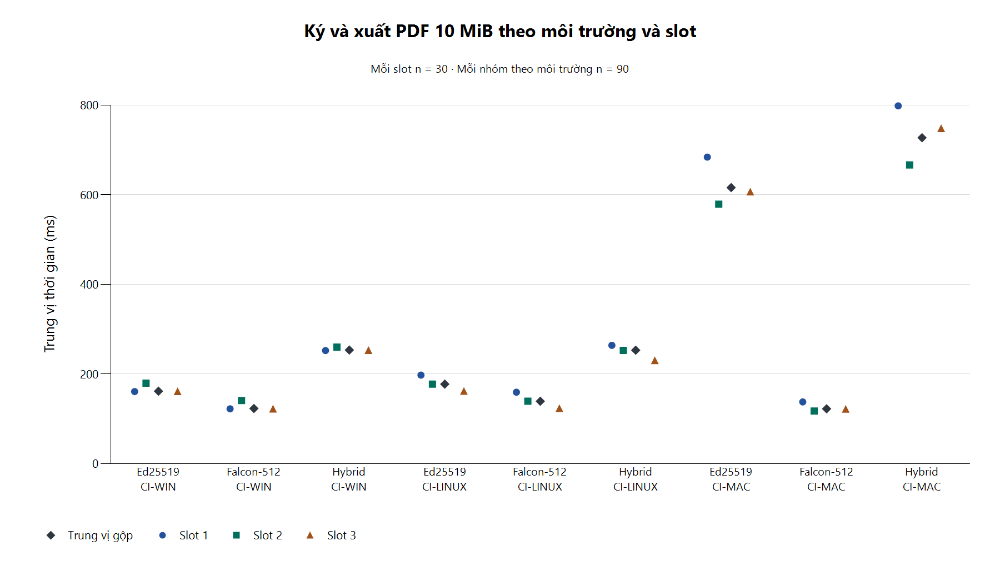
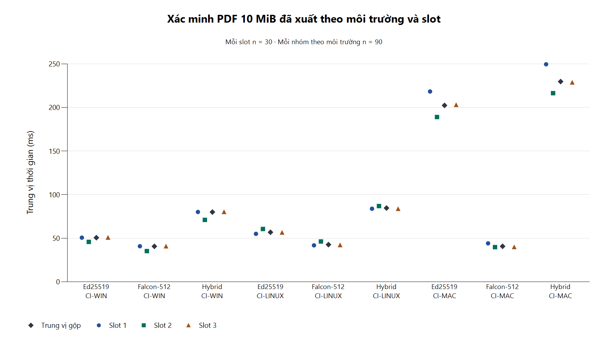

# Phase 5.5C - Kết quả đo chính trên ba môi trường CI

Đủ **9/9 phiên đo** ở ba môi trường x64, với 4.050 lượt đo và 7.560 dòng thời gian. Mỗi môi trường có ba phiên, mỗi phiên có 30 quan sát cho mỗi điều kiện và thao tác. Một lỗi tải bằng chứng C8 xảy ra trước khi đo. Sau khi lưu attempt 1, chỉ job lỗi được chạy lại. [Run chính 44705704103](https://github.com/june2605/falconv1.2-ed25519-thesis/actions/runs/44705704103)

## Nguồn đo và điều phối

- Nguồn đo cố định ở `613a46d06930ffd9224afa557fa90992e3a56a2a`. Tập nguồn thực thi khớp SHA-256 `d2c84e532ebba4b062d25e8f078238d7736b51fc545e3a27aa0b7311d8f4de91`. Giao thức `hybridsign-5.5a-v1` có SHA-256 tệp `protocol.py` là `625aee7677dd8178f8cb1d6b52578f284a9354e1c29deff10f904f0df357112b`. [Giao thức nghiên cứu](phase5-5a-research-protocol.md)
- Commit điều phối `2cecf021ca4b65af8745640d16b38bba854ee632` trên `thesis/ui-demo` thêm `.github/workflows/phase5-5c-main.yml`, `research/orchestration/phase55c.py` và `tests/test_research_phase55c_orchestration.py`. PR #2 đăng ký hai tệp điều phối trên `main` tại `e70f09aea30a5d8d031fd9f579b7de07e6eebb89`. Đó cũng là SHA workflow thực thi ở cả hai attempt. [PR đăng ký](https://github.com/june2605/falconv1.2-ed25519-thesis/pull/2)
- Workflow `424798714` được dispatch một lần từ `main` với `approved=true` và `measurement_source=613a46d…a56a2a`. Workflow chỉ nhận dispatch thủ công, đọc nội dung và Actions, dùng runner chuẩn, có `max-parallel: 1`, `fail-fast: false` và chia sẻ nhóm concurrency với pilot/C8. Mỗi job checkout mã đo và mã điều phối riêng, dùng môi trường Python mới, kiểm tra hồ sơ wheel cố định, rồi gọi CLI đo. Giới hạn job là 25 phút và giới hạn nhận lượt của giao thức là 600 giây. [Workflow đã đăng ký](https://github.com/june2605/falconv1.2-ed25519-thesis/actions/workflows/phase5-5c-main.yml)
- Pilot được chấp nhận là run `44701642390`, attempt 1, ba job thành công, artifact theo thứ tự Windows/Linux/macOS là `14612434111`, `14612454316`, `14613656412`. C8 được chấp nhận là run `44702431300`, attempt 1, **9/9 ô VALID**. Đã kiểm tra 9 ZIP pilot/C8 với digest của GitHub, manifest và kết quả từng ô C8. Các job main dùng lại đúng phiên pilot theo môi trường và đối chiếu bộ bằng chứng C8 đã chốt. [Pilot và C8](phase5-5b-cloud-pilot.md)

## Phiên thực thi và kiểm tra bằng chứng

| Thứ tự | Slot | Attempt | Job ID | Giờ Bangkok (2026) | Artifact ID | Seed | Session UUID | Kết quả |
| --- | --- | --- | --- | --- | --- | --- | --- | --- |
| 1 | CI-WIN-s1 | 1 | [136184651519](https://github.com/june2605/falconv1.2-ed25519-thesis/actions/runs/44705704103/job/136184651519) | 20/11 15:50:14-15:52:17 | 14614552843 | `13144007576086515804` | `919e8428197b4a3e8d762ba734db19a1` | Đủ dữ liệu |
| 2 | CI-WIN-s2 | 1 | [136184651451](https://github.com/june2605/falconv1.2-ed25519-thesis/actions/runs/44705704103/job/136184651451) | 20/11 15:52:19-15:54:19 | 14615206526 | `10675158222977622275` | `dbea18d15e0a4dd5bfd6c793b8f86b5a` | Đủ dữ liệu |
| 3 | CI-WIN-s3 | 1 | [136184650047](https://github.com/june2605/falconv1.2-ed25519-thesis/actions/runs/44705704103/job/136184650047) | 20/11 15:54:21-15:56:29 | 14615830280 | `10682062835127669689` | `0f2f6614b4ac4acdb20abb8aa36c77ca` | Đủ dữ liệu |
| 4 | CI-LINUX-s1 | 1 | [136184651532](https://github.com/june2605/falconv1.2-ed25519-thesis/actions/runs/44705704103/job/136184651532) | 20/11 15:56:30-15:58:15 | 14614389979 | `4070063019313223805` | `142f7a2ded0249f0890df06f09027a07` | Đủ dữ liệu |
| 5 | CI-LINUX-s2 | 1 | [136184651470](https://github.com/june2605/falconv1.2-ed25519-thesis/actions/runs/44705704103/job/136184651470) | 20/11 15:58:17-15:58:52 | 14614694083 | - | - | HTTP 503 trước đo |
| 6 | CI-LINUX-s3 | 1 | [136184651525](https://github.com/june2605/falconv1.2-ed25519-thesis/actions/runs/44705704103/job/136184651525) | 20/11 15:58:54-16:00:45 | 14615137759 | `12396086914108660058` | `0a17e361ad9e46819a2513f0126d2f1e` | Đủ dữ liệu |
| 7 | CI-MAC-s1 | 1 | [136184651504](https://github.com/june2605/falconv1.2-ed25519-thesis/actions/runs/44705704103/job/136184651504) | 20/11 16:00:48-16:04:54 | 14615034174 | `11701009908308613885` | `373ba133b55a43f0bd943cb508969da7` | Đủ dữ liệu |
| 8 | CI-MAC-s2 | 1 | [136184651562](https://github.com/june2605/falconv1.2-ed25519-thesis/actions/runs/44705704103/job/136184651562) | 20/11 16:04:58-16:08:31 | 14615424197 | `9012060537146248888` | `03909bda78114aada7faabd833fc7e55` | Đủ dữ liệu |
| 9 | CI-MAC-s3 | 1 | [136184651517](https://github.com/june2605/falconv1.2-ed25519-thesis/actions/runs/44705704103/job/136184651517) | 20/11 16:08:34-16:12:20 | 14615798458 | `2632647722274933315` | `9dfea8a4f2c14e37acc18f08b9802889` | Đủ dữ liệu |
| 10 | CI-LINUX-s2 | 2 | [137068722227](https://github.com/june2605/falconv1.2-ed25519-thesis/actions/runs/44705704103/job/137068722227) | 22/11 09:36:50-09:38:49 | 14736122066 | `12502685604641665911` | `fa0db7cc0b8f4fca82b709702c52a970` | Đủ dữ liệu |

Attempt 1 có tám phiên thành công. Job `136184651470` nhận `HTTP Error 503: Service Unavailable` ở bước `Validate accepted pilot and C8 evidence`, tại yêu cầu tải ZIP từ GitHub trong chuỗi `prepare → verify_bundle → files_from → GitHub.zip`. Job dừng trước khi bắt đầu tiến trình đo. ZIP của job này chứa metadata điều phối, và log gốc đã được lưu. Attempt 2 thực thi riêng job `137068722227` cho slot `CI-LINUX-s2`. API Jobs liệt kê cả tám kết quả kế thừa với ID mới, nhưng những bản ghi đó có cùng thời gian thực thi, runner và kết quả từng bước như attempt 1. Attempt 2 có đúng một bộ bằng chứng mới. [Attempt 1](https://github.com/june2605/falconv1.2-ed25519-thesis/actions/runs/44705704103/attempts/1) · [Attempt 2](https://github.com/june2605/falconv1.2-ed25519-thesis/actions/runs/44705704103/attempts/2)

Đã kiểm tra 10 ZIP tải về bằng SHA-256 do GitHub công bố, gồm chín phiên hoàn chỉnh và một ZIP điều phối của job lỗi. Đã đối chiếu inventory giải nén, SHA-256 đầu vào, nguồn đo, hồ sơ phụ thuộc, seed, lịch, thứ tự và khoảng thực thi của từng phiên. Chín phiên có UUID và lịch riêng, chạy tuần tự theo thời điểm ghi trong outcome. Tất cả phiên có 3 khối khởi động và 30 khối đo, đủ bản ghi dự kiến. Không có lượt đo lỗi, dở dang hoặc bị loại.

| Phạm vi | Lượt khởi động | Dòng khởi động | Lượt đo | Dòng đo | PDF phần đo |
| --- | ---: | ---: | ---: | ---: | ---: |
| Mỗi phiên | 45 | 84 | 450 | 840 | 270 |
| Mỗi môi trường, 3 phiên | 135 | 252 | 1.350 | 2.520 | 810 |
| Toàn chiến dịch, 9 phiên | 405 | 756 | 4.050 | 7.560 | 2.430 |

Ngoài dòng thời gian, 243 PDF được tạo trong khởi động. Đã xác nhận toàn bộ 10.098 bản ghi đối chứng trong các phiên và 171 kiểm tra smoke. C8 là bằng chứng tương thích chéo đã có từ pilot. [Phân loại đối chứng](phase5-5a-research-protocol.md)

## Môi trường thực tế

| Slot | Runner / phiên bản image | OS / build hoặc kernel | CPU quan sát | Lõi / logic | RAM tổng / còn (GiB) | Hệ tệp / đĩa còn (GiB) | Vòng đo (s) |
| --- | --- | --- | --- | --- | --- | --- | --- |
| CI-WIN-s1 | `windows-2022` / `20261112.366.7` | Microsoft Windows Server 2022 Datacenter / 20348 10.0.20348.5870 | AMD EPYC 7763 64-Core Processor | 2 / 4 | 15,99 / 13,47 | NTFS / 146,86 | 66,94 |
| CI-WIN-s2 | `windows-2022` / `20261112.366.7` | Microsoft Windows Server 2022 Datacenter / 20348 10.0.20348.5870 | AMD EPYC 9V74 80-Core Processor | 2 / 4 | 15,99 / 13,48 | NTFS / 219,72 | 63,34 |
| CI-WIN-s3 | `windows-2022` / `20261112.366.7` | Microsoft Windows Server 2022 Datacenter / 20348 10.0.20348.5870 | AMD EPYC 7763 64-Core Processor | 2 / 4 | 15,99 / 13,48 | NTFS / 146,86 | 67,39 |
| CI-LINUX-s1 | `ubuntu-24.04` / `20261111.370.1` | Ubuntu 24.04.5 LTS / 7.0.0-1017-azure | AMD EPYC 9V74 80-Core Processor | 2 / 4 | 15,61 / 14,54 | ext4 / 84,25 | 70,01 |
| CI-LINUX-s2 | `ubuntu-24.04` / `20261116.133.1` | Ubuntu 24.04.5 LTS / 7.0.0-1014-aws | Intel(R) Xeon(R) 6975P-C | 2 / 4 | 15,33 / 14,27 | ext4 / 87,37 | 66,28 |
| CI-LINUX-s3 | `ubuntu-24.04` / `20261116.133.1` | Ubuntu 24.04.5 LTS / 7.0.0-1014-aws | Intel(R) Xeon(R) 6975P-C | 2 / 4 | 15,33 / 14,23 | ext4 / 87,38 | 60,87 |
| CI-MAC-s1 | `macos-15-intel` / `20260824.0482.1` | macOS 15.7.9 / 24G830 | Intel(R) Core(TM) i7-8700B CPU @ 3.20GHz | 4 / 4 | 14,00 / 9,63 | apfs / 107,69 | 198,96 |
| CI-MAC-s2 | `macos-15-intel` / `20260824.0482.1` | macOS 15.7.9 / 24G830 | Intel(R) Core(TM) i7-8700B CPU @ 3.20GHz | 4 / 4 | 14,00 / 9,56 | apfs / 108,26 | 165,48 |
| CI-MAC-s3 | `macos-15-intel` / `20260824.0482.1` | macOS 15.7.9 / 24G830 | Intel(R) Core(TM) i7-8700B CPU @ 3.20GHz | 4 / 4 | 14,00 / 9,61 | apfs / 107,62 | 183,20 |

RAM khả dụng và đĩa còn trống lấy từ metadata lúc vào phiên. Thời gian vòng đo gồm khởi động và đối chứng ngoài khoảng đo. `physical_host_id` và `physical_parent_id` đều ghi `unknown`.

Mọi phiên dùng CPython 3.11.9 x64, PyNaCl 1.6.2, pqcrypto 0.3.4 và cffi 2.0.0. Hồ sơ `p55a-cp3119-x64-v1` có SHA-256 `f3389d41a7efaa590e3619f46eb9a4529ededb6a45f10ed7e51ba6d26cebbbbb`. SHA-256 wheel và mô-đun thực nạp đã được đối chiếu theo nền tảng trong `session.json` của từng phiên. Các băm Falcon khớp bảng ở Phase 5.5B. [Hồ sơ wheel](../research/benchmarks/p55/wheels.json) · [Băm Falcon theo môi trường](phase5-5b-cloud-pilot.md#môi-trường-và-thư-viện)

## Kết quả PDF

Đơn vị ms. Mỗi cột slot ghi trung vị **ký và xuất / xác minh** với n=30. Hai cột gộp ghi **trung vị / IQR / P95** với n=90 từ ba phiên của cùng môi trường. Ký và xuất tính cả xác minh ứng viên và công bố tệp. Xác minh trong bảng là phép gọi riêng trên tệp đã xuất.

| Môi trường | PDF | Phương pháp | Slot 1 | Slot 2 | Slot 3 | Ký và xuất, gộp | Xác minh, gộp |
| --- | --- | --- | --- | --- | --- | --- | --- |
| CI-WIN | 742 byte | Ed25519 | 3,408 / 0,242 | 2,479 / 0,201 | 3,442 / 0,245 | 3,287 / 0,718 / 4,123 | 0,242 / 0,040 / 0,248 |
| CI-WIN | 742 byte | Falcon-512 | 13,622 / 0,228 | 11,314 / 0,184 | 13,609 / 0,229 | 13,489 / 2,127 / 14,132 | 0,227 / 0,045 / 0,242 |
| CI-WIN | 742 byte | Hybrid | 14,668 / 0,360 | 12,109 / 0,300 | 14,634 / 0,361 | 14,422 / 2,215 / 15,172 | 0,359 / 0,059 / 0,372 |
| CI-WIN | 1 MiB | Ed25519 | 20,430 / 5,459 | 18,659 / 4,981 | 20,294 / 5,450 | 20,228 / 1,101 / 20,940 | 5,411 / 0,457 / 5,620 |
| CI-WIN | 1 MiB | Falcon-512 | 25,153 / 4,338 | 22,775 / 3,735 | 25,157 / 4,324 | 24,992 / 0,763 / 25,929 | 4,288 / 0,539 / 4,378 |
| CI-WIN | 1 MiB | Hybrid | 39,987 / 8,586 | 36,968 / 7,746 | 40,069 / 8,699 | 39,614 / 2,055 / 40,898 | 8,553 / 0,841 / 8,863 |
| CI-WIN | 10 MiB | Ed25519 | 160,884 / 50,669 | 179,609 / 45,827 | 161,667 / 50,924 | 161,742 / 15,818 / 181,444 | 50,621 / 4,767 / 51,497 |
| CI-WIN | 10 MiB | Falcon-512 | 122,360 / 40,815 | 140,952 / 35,273 | 122,751 / 40,965 | 123,137 / 16,068 / 142,360 | 40,687 / 5,436 / 41,562 |
| CI-WIN | 10 MiB | Hybrid | 252,431 / 80,130 | 260,233 / 71,010 | 253,371 / 80,353 | 253,525 / 6,899 / 264,284 | 80,014 / 8,277 / 81,451 |
| CI-LINUX | 742 byte | Ed25519 | 1,481 / 0,104 | 1,051 / 0,075 | 1,085 / 0,077 | 1,327 / 0,458 / 12,506 | 0,080 / 0,028 / 0,112 |
| CI-LINUX | 742 byte | Falcon-512 | 9,413 / 0,107 | 7,913 / 0,088 | 7,818 / 0,089 | 8,042 / 1,599 / 9,694 | 0,092 / 0,019 / 0,111 |
| CI-LINUX | 742 byte | Hybrid | 9,770 / 0,178 | 8,048 / 0,147 | 8,049 / 0,145 | 8,304 / 1,712 / 10,022 | 0,152 / 0,032 / 0,200 |
| CI-LINUX | 1 MiB | Ed25519 | 14,582 / 2,953 | 11,763 / 3,195 | 11,391 / 3,181 | 12,620 / 3,574 / 22,288 | 3,164 / 0,217 / 3,266 |
| CI-LINUX | 1 MiB | Falcon-512 | 20,981 / 3,027 | 16,246 / 3,047 | 15,740 / 3,040 | 18,414 / 4,027 / 39,365 | 3,036 / 0,067 / 3,132 |
| CI-LINUX | 1 MiB | Hybrid | 28,468 / 5,288 | 24,678 / 5,452 | 24,251 / 5,396 | 27,152 / 3,973 / 49,978 | 5,390 / 0,139 / 5,546 |
| CI-LINUX | 10 MiB | Ed25519 | 197,592 / 55,040 | 177,479 / 60,555 | 162,172 / 56,749 | 177,479 / 29,360 / 218,173 | 56,858 / 4,975 / 61,992 |
| CI-LINUX | 10 MiB | Falcon-512 | 159,439 / 41,840 | 139,252 / 46,308 | 123,787 / 42,338 | 139,317 / 33,387 / 182,118 | 42,671 / 3,516 / 47,648 |
| CI-LINUX | 10 MiB | Hybrid | 264,032 / 83,835 | 252,700 / 86,921 | 230,736 / 83,851 | 253,174 / 28,281 / 283,431 | 84,636 / 2,736 / 87,760 |
| CI-MAC | 742 byte | Ed25519 | 3,203 / 0,284 | 2,802 / 0,250 | 2,901 / 0,257 | 2,981 / 0,417 / 3,847 | 0,262 / 0,035 / 0,323 |
| CI-MAC | 742 byte | Falcon-512 | 11,452 / 0,205 | 10,000 / 0,171 | 10,371 / 0,181 | 10,464 / 1,178 / 12,969 | 0,181 / 0,023 / 0,225 |
| CI-MAC | 742 byte | Hybrid | 13,054 / 0,406 | 11,518 / 0,344 | 11,785 / 0,369 | 11,819 / 1,164 / 14,431 | 0,363 / 0,056 / 0,445 |
| CI-MAC | 1 MiB | Ed25519 | 65,091 / 20,435 | 56,908 / 17,910 | 60,649 / 19,741 | 60,205 / 7,873 / 92,107 | 18,952 / 2,416 / 23,078 |
| CI-MAC | 1 MiB | Falcon-512 | 21,931 / 4,002 | 19,396 / 3,645 | 19,932 / 3,692 | 19,965 / 2,557 / 24,726 | 3,734 / 0,369 / 4,735 |
| CI-MAC | 1 MiB | Hybrid | 81,828 / 23,393 | 73,193 / 20,868 | 77,496 / 21,154 | 76,400 / 8,587 / 100,613 | 21,586 / 2,764 / 26,356 |
| CI-MAC | 10 MiB | Ed25519 | 683,985 / 218,328 | 578,988 / 189,053 | 606,941 / 203,162 | 616,014 / 108,590 / 1113,937 | 202,366 / 28,641 / 247,398 |
| CI-MAC | 10 MiB | Falcon-512 | 137,805 / 44,140 | 117,415 / 39,817 | 122,254 / 40,069 | 122,419 / 23,310 / 230,432 | 40,751 / 5,139 / 47,478 |
| CI-MAC | 10 MiB | Hybrid | 798,262 / 249,548 | 666,339 / 216,406 | 748,551 / 228,883 | 727,286 / 170,618 / 1278,298 | 229,707 / 34,138 / 285,310 |

Mẫu quan sát ở pilot lặp lại trong cả ba phiên main trên runner macOS Intel. Với PDF 10 MiB, trung vị ký và xuất Ed25519 là 578,988-683,985 ms trên ba phiên đó, 160,884-179,609 ms trên Windows và 162,172-197,592 ms trên Linux. Trung vị Hybrid trên macOS là 666,339-798,262 ms. Với Falcon-512, khoảng 117,415-137,805 ms trên macOS chồng lấn với khoảng 122,360-159,439 ms trên Windows và Linux. Trên CI-LINUX, cả ba phương pháp ký và xuất PDF 10 MiB có trung vị cao nhất ở slot 1, nơi ghi nhận CPU, kernel và image khác hai slot còn lại. Đây là các quan sát về toàn bộ quy trình PDF. Ed25519 xử lý vùng byte được bao phủ, còn Falcon ký giá trị SHAKE256 dài 64 byte. Nguyên nhân của chênh lệch giữa các runner chưa được xác định. [Kết quả pilot](phase5-5b-cloud-pilot.md#độ-trễ-pdf-đã-tái-tính)





### So sánh ghép cặp

Mỗi ô ghi **trung vị / IQR**, n=90. Hiệu và tỷ số được tính trên từng cặp cùng phiên, cùng khối, cùng tệp và thao tác rồi mới tổng hợp. Tất cả mẫu số đều dương.

| Môi trường | PDF | Thao tác | Hybrid trừ Ed25519 (ms) | Hybrid chia Ed25519 | Hybrid trừ Falcon (ms) | Hybrid chia Falcon |
| --- | --- | --- | --- | --- | --- | --- |
| CI-WIN | 742 byte | Ký và xuất | 10,869 / 1,309 | 4,384 / 0,486 | 0,880 / 0,573 | 1,069 / 0,045 |
| CI-WIN | 742 byte | Xác minh | 0,115 / 0,016 | 1,482 / 0,028 | 0,130 / 0,016 | 1,593 / 0,057 |
| CI-WIN | 1 MiB | Ký và xuất | 19,452 / 1,171 | 1,961 / 0,075 | 14,734 / 1,186 | 1,595 / 0,055 |
| CI-WIN | 1 MiB | Xác minh | 3,075 / 0,465 | 1,573 / 0,056 | 4,202 / 0,351 | 2,012 / 0,093 |
| CI-WIN | 10 MiB | Ký và xuất | 90,438 / 6,918 | 1,559 / 0,093 | 129,408 / 8,958 | 2,049 / 0,179 |
| CI-WIN | 10 MiB | Xác minh | 29,022 / 3,686 | 1,574 / 0,038 | 39,070 / 3,155 | 1,972 / 0,045 |
| CI-LINUX | 742 byte | Ký và xuất | 7,147 / 1,318 | 7,116 / 2,405 | 0,298 / 0,481 | 1,035 / 0,058 |
| CI-LINUX | 742 byte | Xác minh | 0,072 / 0,011 | 1,891 / 0,298 | 0,061 / 0,016 | 1,660 / 0,130 |
| CI-LINUX | 1 MiB | Ký và xuất | 13,045 / 5,791 | 2,064 / 0,750 | 8,144 / 5,361 | 1,496 / 0,307 |
| CI-LINUX | 1 MiB | Xác minh | 2,271 / 0,135 | 1,721 / 0,087 | 2,342 / 0,135 | 1,771 / 0,049 |
| CI-LINUX | 10 MiB | Ký và xuất | 69,798 / 11,070 | 1,407 / 0,077 | 107,714 / 9,888 | 1,810 / 0,183 |
| CI-LINUX | 10 MiB | Xác minh | 27,564 / 2,852 | 1,481 / 0,090 | 41,553 / 1,880 | 1,973 / 0,103 |
| CI-MAC | 742 byte | Ký và xuất | 8,860 / 0,912 | 4,010 / 0,322 | 1,401 / 0,793 | 1,136 / 0,076 |
| CI-MAC | 742 byte | Xác minh | 0,104 / 0,029 | 1,395 / 0,086 | 0,185 / 0,036 | 2,016 / 0,115 |
| CI-MAC | 1 MiB | Ký và xuất | 16,325 / 5,059 | 1,281 / 0,091 | 55,794 / 7,412 | 3,788 / 0,325 |
| CI-MAC | 1 MiB | Xác minh | 2,840 / 1,805 | 1,153 / 0,104 | 17,819 / 2,224 | 5,767 / 0,423 |
| CI-MAC | 10 MiB | Ký và xuất | 103,296 / 89,294 | 1,163 / 0,122 | 599,062 / 144,882 | 5,856 / 0,640 |
| CI-MAC | 10 MiB | Xác minh | 28,821 / 23,683 | 1,152 / 0,111 | 187,122 / 31,987 | 5,562 / 0,549 |

### Sinh khóa và phép đo mức thuật toán

Đơn vị µs. Mỗi ô ghi **trung vị / IQR / P95** với n=90. Phép đo ký và xác minh dùng thông điệp 64 hoặc 1.024 byte và khóa đã chuẩn bị theo giao thức.

| Bộ thuật toán | Đầu vào | Thao tác | CI-WIN | CI-LINUX | CI-MAC |
| --- | --- | --- | --- | --- | --- |
| Ed25519 | Sinh khóa | - | 60,700 / 10,800 / 71,410 | 39,576 / 17,506 / 60,427 | 102,446 / 12,903 / 123,894 |
| Ed25519 | 64 byte | Ký | 45,150 / 4,025 / 49,855 | 24,662 / 7,601 / 32,276 | 85,596 / 11,497 / 100,647 |
| Ed25519 | 64 byte | Xác minh | 119,050 / 14,650 / 122,310 | 46,918 / 11,005 / 58,426 | 152,971 / 20,876 / 185,111 |
| Ed25519 | 1.024 byte | Ký | 52,300 / 3,625 / 57,600 | 28,873 / 7,917 / 36,566 | 117,436 / 15,144 / 149,358 |
| Ed25519 | 1.024 byte | Xác minh | 121,850 / 14,450 / 124,310 | 47,829 / 11,217 / 61,673 | 166,542 / 20,368 / 194,699 |
| Falcon-512 | Sinh khóa | - | 16808,550 / 6864,650 / 26556,465 | 11765,319 / 5657,241 / 22413,048 | 12614,725 / 5038,580 / 24859,948 |
| Falcon-512 | 64 byte | Ký | 5067,100 / 650,725 / 5171,715 | 3326,833 / 630,731 / 3952,150 | 3837,349 / 368,409 / 4380,276 |
| Falcon-512 | 64 byte | Xác minh | 58,700 / 9,850 / 60,355 | 42,305 / 4,408 / 46,845 | 53,270 / 6,260 / 66,986 |
| Falcon-512 | 1.024 byte | Ký | 5067,050 / 665,175 / 5182,840 | 3321,571 / 633,058 / 3958,565 | 3831,383 / 353,992 / 4585,080 |
| Falcon-512 | 1.024 byte | Xác minh | 63,000 / 10,725 / 66,005 | 45,333 / 4,451 / 49,675 | 57,472 / 6,583 / 70,129 |

### Kích thước đầu ra

| Phương pháp | Tăng trưởng PDF (byte) | Chữ ký native quan sát được (byte) | Số PDF phần đo |
| --- | ---: | --- | ---: |
| Ed25519 | 394 | Ed25519 64 | 810 |
| Falcon-512 | 4.232 | Falcon 649-661 | 810 |
| Hybrid | 4.626 | Ed25519 64 và Falcon 649-662 | 810 |

Tăng trưởng bằng tổng độ dài container được nối vào tệp. Mức tăng trên giữ nguyên cho cả ba cỡ PDF với cấu hình đo. Kích thước chữ ký native được lấy từ chữ ký sau giải mã hex trong CSV, riêng với phần dung lượng container.

## Lưu trữ và tái tính

Bằng chứng lưu ngoài Git và Temp tại `%LOCALAPPDATA%\HybridSignResearch\phase5-5c\campaign-81d76271`. Hai thư mục `run-44705704103-a1` và `run-44705704103-a2` giữ metadata gốc, log, ZIP, dữ liệu giải nén và inventory. `campaign-checksums.sha256` đã được đọc lại và kiểm đủ **179 tệp**, SHA-256 `ab0bcc2118f5d1261bd9da7321b838154c00c0de1efde97933b5c50366e53829`. Artifact trên GitHub có chính sách lưu 30 ngày.

`verified-main.json` liên kết mỗi phiên với attempt, job, lịch và các băm. `summary-main.json` có SHA-256 `7ff23a8412216fb1306a0f8a058b3fe06039b78b807d64159c1c33811e5f7868`. Đã tái tính độc lập từ 7.560 dòng đo và xác nhận 336 chuỗi thời gian, 144 nhóm ghép cặp, gồm các phân vị Type 7 và độ lệch chuẩn mẫu. Các CSV dẫn xuất là `timings-by-slot.csv`, `timings-by-environment.csv`, `paired-differences-and-ratios.csv` và `output-sizes-by-slot.csv`.

Tái tính từ các thư mục phiên đã lưu, với PowerShell và môi trường nghiên cứu đã có. Tệp đầu ra mới nằm kề thư mục chiến dịch.

```powershell
$c = Join-Path $env:LOCALAPPDATA 'HybridSignResearch\phase5-5c\campaign-81d76271'
$snap = Join-Path (Split-Path -Parent $c) 'measurement-81d76271'
$env55 = Join-Path $env:LOCALAPPDATA 'HybridSignResearch\phase5-5a\venv-win-cp3119'
$p55 = Join-Path $env55 'Scripts\python.exe'
$audit = Get-Content -LiteralPath (Join-Path $c 'verified-main.json') -Raw | ConvertFrom-Json
$paths = @($audit.jobs | Where-Object session_path | ForEach-Object { Join-Path $c $_.session_path })
$out = Join-Path (Split-Path -Parent $c) ("summary-check-" + [guid]::NewGuid().ToString('N') + ".json")
Push-Location $snap
try {
    & $p55 -B -m research.benchmarks.p55 summarize --campaign @paths --output $out
    if ($LASTEXITCODE -ne 0) { throw 'Summarize failed.' }
} finally { Pop-Location }
if ((Get-FileHash -LiteralPath $out).Hash -cne (Get-FileHash -LiteralPath (Join-Path $c 'summary-main.json')).Hash) {
    throw 'Summary digest mismatch.'
}
```

Bản công bố kết quả thêm báo cáo này, hai hình PNG và `research/orchestration/phase55c_charts.ps1`. Khi xác nhận lại, **47 pytest đạt** trong hai tệp kiểm thử nghiên cứu và actionlint đạt. Môi trường `.venv` mặc định thiếu PyYAML cho bộ kiểm thử YAML, nên lần xác nhận dùng đúng môi trường nghiên cứu `venv-win-cp3119` đã có. Đối chiếu SHA-256 cuối kỳ cho 37 tệp nguồn và nghiên cứu đã chốt, hai bộ chữ ký đóng băng, PDF mẫu công khai, 15 tệp benchmark gốc, 138 tệp payload portable, ba hiện vật phát hành và 96 tệp bằng chứng Phase 5.5B đều khớp. [Baseline](phase5-5a-baseline.json)

## Phạm vi kết luận

Kết quả mô tả cấu hình, bộ đầu vào, runner và thư viện đã đo. Mỗi n=90 gồm các phép đo lặp trong ba phiên logic. P95 mô tả phân bố quan sát của mẫu. CPU, image, kernel, hệ tệp và binary theo nền tảng có thể cùng ảnh hưởng đến số đo, nên dữ liệu hiện tại chỉ hỗ trợ so sánh mô tả. Phân tích nguyên nhân của chênh lệch macOS cần một thí nghiệm tách riêng các thành phần thời gian. Phạm vi đa nền tảng của bằng chứng là CLI nghiên cứu và xác minh C8. Những kết luận về desktop GUI, nhận dạng người ký, thời gian ký tin cậy, toàn vẹn với mọi biến đổi và tuân thủ tiêu chuẩn cần bằng chứng riêng.
