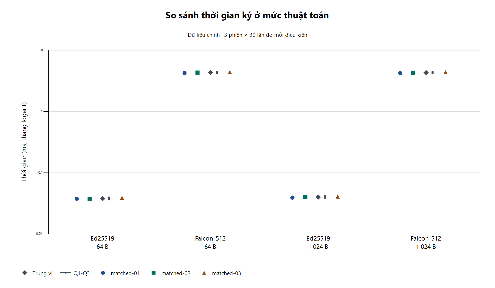
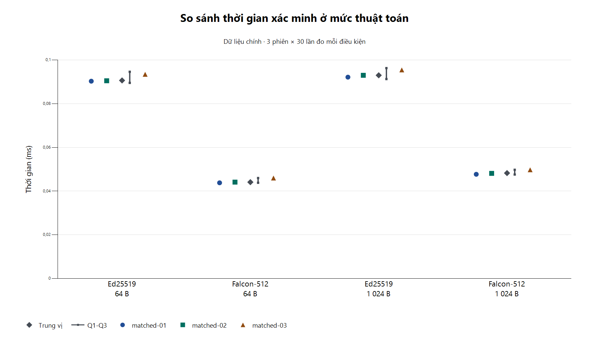
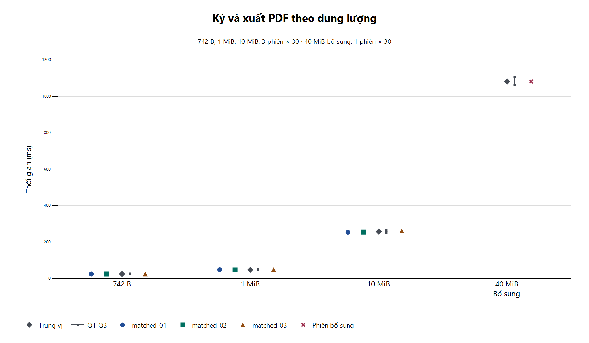
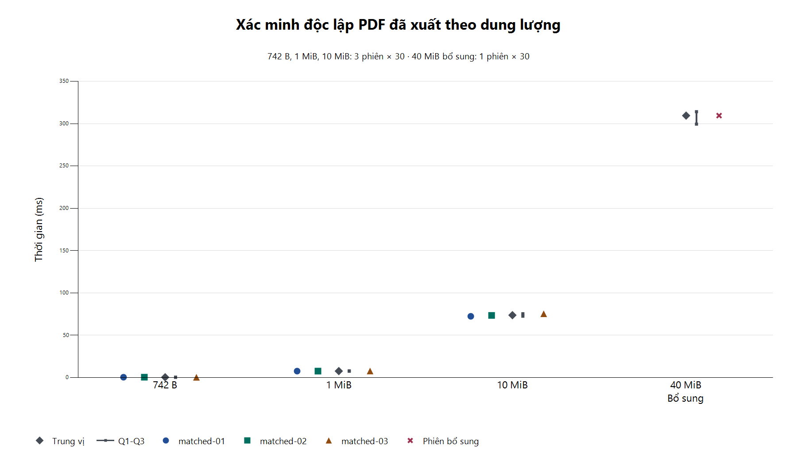
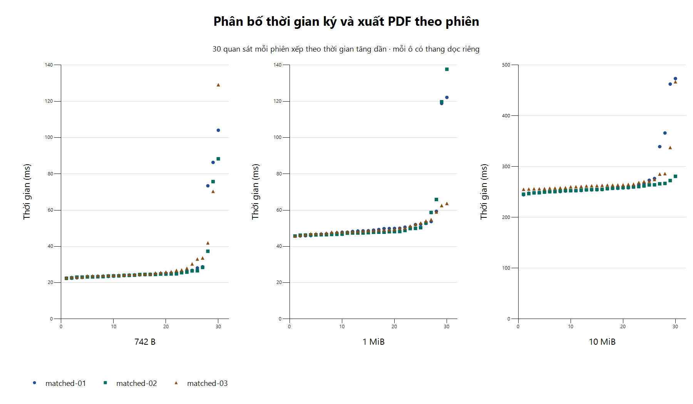

# Chương X. Phương pháp và kết quả thực nghiệm

> **Bản thảo tạm thời.** Số chương, bảng và hình dùng ký hiệu X cho đến khi có đề cương và quy cách trình bày được trường phê duyệt. Bản thảo dựa trên bố cục nghiên cứu nội bộ. [Đề xuất bố cục](phase5-1-thesis-traceability.md#proposed-chapter-structure)

## X.1. Mục tiêu

Thực nghiệm trả lời ba câu hỏi. Thứ nhất, độ trễ ký và xác minh của hai thư viện khác nhau như thế nào khi xử lý cùng thông điệp công khai? Thứ hai, kích thước PDF ảnh hưởng ra sao đến thời gian ký và xuất tệp, thời gian xác minh độc lập và chi phí lưu trữ của HybridSign? Thứ ba, quy trình phản hồi như thế nào khi dùng đúng khóa, thay đổi nội dung thuộc vùng ký hoặc dùng sai cặp khóa công khai? Phạm vi nghiên cứu là phiên bản và môi trường được ghi nhận tại thời điểm đo. [Chỉ mục bằng chứng](phase5-3-evidence-index.md)

## X.2. Thiết kế thực nghiệm

### X.2.1. Môi trường và cài đặt mật mã

Đợt đo diễn ra ngày 19/11/2026 trên một máy chạy Windows 11 Pro AMD64, bản dựng `26200.9974`. Máy sử dụng Intel Core i7-10850H, tần số danh định 2,70 GHz, 6 lõi vật lý, 12 bộ xử lý logic và 16 762 388 480 byte RAM theo báo cáo hệ điều hành. Dữ liệu được ghi trên ổ NTFS cục bộ. Mỗi tiến trình ghi nhận nguồn AC, chế độ nguồn Balanced và chế độ tiết kiệm pin tắt ở đầu và cuối phiên. Đây là cấu hình quan sát được. Tần số thực tế, bộ đệm hệ thống và tải nền thông thường có thể dao động. [Thông số ghi trong chiến dịch](phase5-2b-experimental-results.md#conditions-and-per-process-counts)

Bản đo dùng CPython 3.11.9, PyNaCl 1.6.2 cho Ed25519 và `pqcrypto` 0.3.4 cho Falcon-512. Ed25519 là biến thể EdDSA được mô tả trong RFC 8032. Tên mô-đun được đo cho Falcon là `falcon_512`, biến thể PQClean clean với dòng mã nguồn được truy nguyên đến `2cc64716044832eea747234ddbffc06746ab815d`. Falcon Specification v1.2 dùng làm tài liệu lý thuyết. Định danh gói, định danh triển khai và phiên bản đặc tả là ba thông tin khác nhau. [RFC 8032, mục 5.1](https://www.rfc-editor.org/rfc/rfc8032.html#section-5.1) · [Falcon Specification v1.2](https://falcon-sign.info/falcon.pdf) · [Truy nguyên triển khai Falcon](falcon-implementation-provenance.md)

Tất cả các phiên dùng commit nguồn `3ebfe31abb080a0355ac512d6190910d33e98a63` và bộ đo `phase5_2a.py` phiên bản 1.0.0. Bản phân tích kiểm tra SHA-256 của bộ đo, các mô-đun thực thi và các tệp đầu vào. Năm tiến trình có PID và mã thử nghiệm riêng, chạy lần lượt trên cùng một máy. Mỗi tiến trình có một luồng Python hoạt động tại thời điểm ghi cấu hình đầu và cuối phiên, ngưỡng thu gom rác mặc định `(700, 10, 10)` và khoảng chuyển luồng Python `0,005 s`. Thu gom rác được bật. Các phiên giữ nguyên cách lập lịch hệ điều hành và nguồn ngẫu nhiên mật mã của thư viện. [Bộ đo](../research/benchmarks/phase5_2a.py) · [Danh sách mã băm và phiên](phase5-3-evidence-index.md)

### X.2.2. Dữ liệu đầu vào và số lần lặp

**Bảng X.1. Ma trận điều kiện thử nghiệm.**

| Nhóm | Đầu vào | Kích thước chính xác | Điều kiện đo |
| --- | --- | ---: | --- |
| Thuật toán thành phần | `64-B` | 64 byte | Ed25519 và Falcon-512 nhận cùng mảng byte. Đo riêng ký và xác minh |
| Thuật toán thành phần | `1024-B` | 1 024 byte | Ed25519 và Falcon-512 nhận cùng mảng byte. Đo riêng ký và xác minh |
| PDF chính | `demo` | 742 byte | Mẫu công khai trong kho mã. Đo quy trình HybridSign ở hai chế độ |
| PDF chính | `1-MiB` | 1 048 576 byte | PDF có cấu trúc được kiểm tra, được tạo từ mẫu công khai |
| PDF chính | `10-MiB` | 10 485 760 byte | PDF có cấu trúc được kiểm tra, được tạo từ mẫu công khai |
| PDF bổ sung | `40-MiB` | 41 943 040 byte | PDF được kiểm tra riêng về tính khả thi và tài nguyên |

Hai thông điệp mức thuật toán được tạo theo quy tắc xác định, rồi dùng chung cho hai thuật toán trong cùng một khối. Các PDF mở rộng được tạo xác định từ cùng mẫu công khai, kiểm tra kích thước chính xác, cấu trúc tham chiếu chéo và đoạn kết theo kiểm tra của bộ đo. Do đó, các tệp đại diện cho một họ đầu vào kiểm soát được về kích thước. Chúng không bao quát các cấu trúc PDF phức tạp trong thực tế. [Sinh thông điệp và kiểm tra PDF](../research/benchmarks/phase5_2a.py#L72) · [SHA-256 của đầu vào](phase5-2b-experimental-results.md#conditions-and-per-process-counts)

Mỗi phiên chính có 3 khối khởi động và 30 khối đo. Một khối gồm 2 lượt chuẩn bị thông điệp, 4 lượt thuật toán tương ứng với hai kích thước thông điệp và hai thuật toán, cùng 6 lượt PDF tương ứng với ba kích thước và hai chế độ đo. Thứ tự hai thuật toán đảo theo số khối chẵn/lẻ. Thứ tự PDF luân phiên theo khối và hai chế độ PDF đổi thứ tự ở mỗi khối. Thứ tự này xác định được từ mã nguồn. Thông tin thứ tự được lưu theo từng lượt. Hai phiên bổ sung lặp các điều kiện thành phần, mẫu 742 byte và PDF 40 MiB, tổng cộng 10 lượt mỗi khối. [Lịch chạy trong bộ đo](../research/benchmarks/phase5_2a.py#L348)

**Bảng X.2. Tổ chức phiên và số lượng dữ liệu.**

| Phiên | PID Python | Khối khởi động / đo | Lượt khởi động / đo | Dòng CSV khởi động / đo |
| --- | ---: | ---: | ---: | ---: |
| `matched-01` | 23808 | 3 / 30 | 36 / 360 | 591 / 5 910 |
| `matched-02` | 11940 | 3 / 30 | 36 / 360 | 591 / 5 910 |
| `matched-03` | 24448 | 3 / 30 | 36 / 360 | 591 / 5 910 |
| `optional-40-feasibility` | 18908 | 1 / 1 | 10 / 10 | 140 / 140 |
| `optional-40-measured` | 24084 | 3 / 30 | 30 / 300 | 420 / 4 200 |

Một **lượt** là một mục trong lịch của một khối. Một **quan sát** là một giá trị của một đại lượng cụ thể trong một lượt, chẳng hạn độ trễ xác minh. Một lượt ký có thể ghi nhiều quan sát và kích thước, mỗi đại lượng một dòng. Toàn bộ chiến dịch có 148 lượt khởi động, 1 390 lượt đo và 24 403 dòng CSV, trong đó 2 333 dòng thuộc khởi động. Phép thống kê sử dụng 30 quan sát trên mỗi điều kiện, thao tác và phiên chính, tương ứng 90 quan sát khi gộp ba phiên. Mẫu khảo sát khả thi và 30 quan sát bổ sung của PDF 40 MiB được giữ thành từng nhóm riêng. [Số đếm và nhật ký](phase5-3-evidence-index.md)

### X.2.3. Ranh giới đo

Ở mức thuật toán, lượt thử chuẩn bị khóa riêng trước khi bắt đầu tính thời gian ký. Giá trị ký là thời gian của một lời gọi ký vào thư viện qua Python. PyNaCl trích chữ ký rời từ đối tượng trả về sau khi kết thúc khoảng đo. Giá trị xác minh là thời gian của một lời gọi xác minh hợp lệ với thông điệp, khóa công khai và chữ ký đã chuẩn bị. Thời gian sinh khóa được ghi thành đại lượng riêng. Kiểm tra trên thông điệp đã sửa diễn ra sau phần đo hợp lệ. [`primitive_trial()`](../research/benchmarks/phase5_2a.py#L156)

Ở mức PDF, `sign_with_key_material()` nhận cặp khóa lai trong bộ nhớ. Lời gọi chụp dữ liệu nguồn, kiểm tra khóa, ký Ed25519 lên các đoạn byte thuộc phiên bản thứ nhất, rồi ký Falcon-512 trên đầu ra SHAKE256 dài 64 byte của các vùng được bảo vệ ở phiên bản kế tiếp. Vùng Falcon bao phủ toàn bộ vùng chứa Ed25519. Hàm tên `compute_sha512_digest_for_byte_range()` thực hiện phép ghép các đoạn byte đưa vào Ed25519. SHA-512 nội bộ thuộc cài đặt Ed25519. SHAKE256 ở lớp Falcon là một tiền xử lý rõ ràng ở cấp ứng dụng. [`_sign_captured()`](../sign.py#L74) · [Hai hàm tạo thông điệp](../utils.py#L267) · [FIPS 202, SHAKE256](https://csrc.nist.gov/pubs/fips/202/final)

Đại lượng **ký và xuất** bắt đầu tại điểm gọi `sign_with_key_material()` và kết thúc khi hàm trả về. Khoảng đo bao gồm thao tác lưu trung gian, ghi và `fsync` tệp tạm, đóng tệp tạm, tự xác minh cả hai lớp trên tệp này và công bố kết quả bằng thay thế nguyên tử. Đại lượng **xác minh tệp đã xuất** tính một lần gọi `verify_file_with_public_keys()` sau đó, gồm đọc tệp, kiểm tra cấu trúc và xác minh cả hai chữ ký. Giờ khởi tạo GUI, thao tác hộp thoại, mở khóa kho khóa và tạo PDF đầu vào nằm ngoài các khoảng đo. [Giao dịch xuất tệp](../signing_io.py#L114) · [Xác minh theo khóa công khai](../verify.py#L24) · [`hybrid_trial()`](../research/benchmarks/phase5_2a.py#L222)

Chế độ `unprofiled` đo hai đại lượng của quy trình thực tế với bộ ký nguyên trạng. Chế độ `profiled` bọc các lời gọi của chính quy trình đó để ghi riêng ghép vùng Ed25519, ký từng thuật toán, tiền băm, tạo và điền vùng chứa, ghi tệp tạm, tự xác minh và công bố. Kết quả của hai chế độ được phân tích riêng. Các trường thời gian kế thừa trong tuple trả về có đơn vị giây và phạm vi cấp bước, khác với phép đo toàn lời gọi. [`profile_pipeline()`](../research/benchmarks/phase5_2a.py#L184)

### X.2.4. Thiết bị đo và thống kê

Bộ đo lấy hiệu hai giá trị `time.perf_counter_ns()`, lưu dưới dạng số nguyên nano giây. Độ phân giải báo cáo ở môi trường này là 100 ns. Thời gian biểu diễn bằng mili giây (ms), làm tròn khi trình bày. Tạm dừng lịch chạy hoặc chờ I/O trong khoảng đo được phản ánh vào thời gian trôi qua. [Tài liệu Python 3.11 về bộ đếm hiệu năng](https://docs.python.org/3.11/library/time.html#time.perf_counter_ns) · [Lớp ghi thời gian](../research/benchmarks/phase5_2a.py#L118)

Báo cáo dùng trung vị, trung bình số học, độ lệch chuẩn mẫu (SD, mẫu số `n − 1`), khoảng tứ phân vị (`IQR = Q3 − Q1`) và phân vị 95% (P95). Q1, Q3 và P95 nội suy tuyến tính giữa hai quan sát liên tiếp trong dãy xếp tăng dần tại thứ hạng một gốc `1 + p(n − 1)`, tương ứng với quy tắc Hyndman–Fan loại 7. Hàm `statistics.quantiles(..., method="inclusive")` được dùng để tính các phân vị đó. P95 được trình bày cho các nhóm từ 30 quan sát. Không ước lượng SD, IQR hay P95 từ một lượt khảo sát khả thi. Giá trị chậm được giữ trong mẫu. Dữ liệu thô ghi riêng khởi động, trạng thái và thứ tự, nên có thể kiểm tra tính đầy đủ trước khi tính. Các kết quả là thống kê mô tả. Ba tiến trình trên cùng phần cứng cho phép quan sát biến thiên giữa các phiên trong điều kiện máy đã nêu. [Hyndman và Fan, 1996](https://doi.org/10.1080/00031305.1996.10473566) · [Tài liệu Python 3.11 về phân vị](https://docs.python.org/3.11/library/statistics.html#statistics.quantiles) · [Mã tái tạo](../research/benchmarks/phase5_3_thesis.py)

### X.2.5. Điều kiện bổ sung 40 MiB

Tệp 40 MiB có kích thước 41 943 040 byte, dưới giới hạn 52 428 800 byte của ứng dụng desktop. Kiểm tra ban đầu dành biên dự phòng 2 013 265 920 byte RAM và 528 482 304 byte đĩa cho các bản sao trung gian, tệp đầu vào và vùng dự phòng. Đây là ngưỡng lập kế hoạch, chưa phải đỉnh sử dụng tài nguyên đo được. Tại lần kiểm tra đầu, còn 7 229 509 632 byte RAM và 18 608 349 184 byte đĩa. Một khối khởi động và một khối đo khả thi hoàn thành trong tiến trình dài 10,973 s và vượt qua các kiểm tra xác minh. Phép chiếu thận trọng `10,9730709 × 33` cho 362,111 s, vượt ngưỡng nhận lượt ban đầu 300 s. [Giới hạn desktop](../desktop/pdf_io.py#L15) · [Hồ sơ tiền kiểm](phase5-2b-experimental-results.md#optional-40-mib-decision)

Sau khi xác nhận lại còn 7 250 800 640 byte RAM và 18 564 227 072 byte đĩa, phiên bổ sung dùng ngưỡng nhận lượt 600 s vốn được bộ đo hỗ trợ. Tiến trình hoàn thành trong 149,089 s, với 3 lượt khởi động và 30 lượt đo cho mỗi chế độ của PDF 40 MiB. Ngưỡng kiểm tra trước khi nhận lượt mới. Tất cả số liệu 40 MiB được đánh dấu là bổ sung. [Hồ sơ phiên và ngưỡng](phase5-3-evidence-index.md)

## X.3. Kết quả thời gian ở mức thuật toán

**Bảng X.3. Phân bố độ trễ theo thuật toán và thông điệp, gộp ba phiên (ms).**

| Thông điệp | Thuật toán | Thao tác | n | Trung vị | IQR | Trung bình | SD mẫu | P95 |
| --- | --- | --- | --- | --- | --- | --- | --- | --- |
| 64 B | Ed25519 | Ký | 90 | 0,038 | 0,002 | 0,040 | 0,008 | 0,051 |
| 64 B | Ed25519 | Xác minh | 90 | 0,091 | 0,005 | 0,094 | 0,012 | 0,111 |
| 64 B | Falcon-512 | Ký | 90 | 4,357 | 0,195 | 4,409 | 0,275 | 4,830 |
| 64 B | Falcon-512 | Xác minh | 90 | 0,044 | 0,002 | 0,047 | 0,010 | 0,059 |
| 1 024 B | Ed25519 | Ký | 90 | 0,040 | 0,003 | 0,042 | 0,009 | 0,045 |
| 1 024 B | Ed25519 | Xác minh | 90 | 0,093 | 0,005 | 0,098 | 0,013 | 0,121 |
| 1 024 B | Falcon-512 | Ký | 90 | 4,330 | 0,193 | 4,355 | 0,148 | 4,640 |
| 1 024 B | Falcon-512 | Xác minh | 90 | 0,048 | 0,002 | 0,050 | 0,008 | 0,053 |

**Bảng X.4. Độ trễ theo phiên, thuật toán và thông điệp (ms).**

| Phiên | Thông điệp | Thuật toán | Thao tác | n | Trung vị | IQR | Trung bình | SD mẫu | P95 |
| --- | --- | --- | --- | --- | --- | --- | --- | --- | --- |
| matched-01 | 64 B | Ed25519 | Ký | 30 | 0,037 | 0,002 | 0,041 | 0,011 | 0,065 |
| matched-01 | 64 B | Ed25519 | Xác minh | 30 | 0,090 | 0,004 | 0,096 | 0,019 | 0,118 |
| matched-01 | 64 B | Falcon-512 | Ký | 30 | 4,266 | 0,142 | 4,389 | 0,399 | 4,782 |
| matched-01 | 64 B | Falcon-512 | Xác minh | 30 | 0,044 | 0,000 | 0,047 | 0,009 | 0,069 |
| matched-01 | 1 024 B | Ed25519 | Ký | 30 | 0,039 | 0,001 | 0,039 | 0,001 | 0,042 |
| matched-01 | 1 024 B | Ed25519 | Xác minh | 30 | 0,092 | 0,002 | 0,095 | 0,008 | 0,113 |
| matched-01 | 1 024 B | Falcon-512 | Ký | 30 | 4,251 | 0,119 | 4,282 | 0,094 | 4,458 |
| matched-01 | 1 024 B | Falcon-512 | Xác minh | 30 | 0,048 | 0,000 | 0,049 | 0,006 | 0,051 |
| matched-02 | 64 B | Ed25519 | Ký | 30 | 0,037 | 0,002 | 0,038 | 0,004 | 0,045 |
| matched-02 | 64 B | Ed25519 | Xác minh | 30 | 0,090 | 0,002 | 0,092 | 0,007 | 0,102 |
| matched-02 | 64 B | Falcon-512 | Ký | 30 | 4,328 | 0,154 | 4,354 | 0,150 | 4,586 |
| matched-02 | 64 B | Falcon-512 | Xác minh | 30 | 0,044 | 0,001 | 0,045 | 0,005 | 0,049 |
| matched-02 | 1 024 B | Ed25519 | Ký | 30 | 0,040 | 0,003 | 0,044 | 0,015 | 0,057 |
| matched-02 | 1 024 B | Ed25519 | Xác minh | 30 | 0,093 | 0,003 | 0,100 | 0,020 | 0,157 |
| matched-02 | 1 024 B | Falcon-512 | Ký | 30 | 4,302 | 0,150 | 4,330 | 0,133 | 4,570 |
| matched-02 | 1 024 B | Falcon-512 | Xác minh | 30 | 0,048 | 0,001 | 0,052 | 0,013 | 0,076 |
| matched-03 | 64 B | Ed25519 | Ký | 30 | 0,039 | 0,003 | 0,040 | 0,007 | 0,042 |
| matched-03 | 64 B | Ed25519 | Xác minh | 30 | 0,093 | 0,008 | 0,095 | 0,008 | 0,104 |
| matched-03 | 64 B | Falcon-512 | Ký | 30 | 4,418 | 0,209 | 4,485 | 0,200 | 4,830 |
| matched-03 | 64 B | Falcon-512 | Xác minh | 30 | 0,046 | 0,004 | 0,049 | 0,014 | 0,051 |
| matched-03 | 1 024 B | Ed25519 | Ký | 30 | 0,041 | 0,003 | 0,042 | 0,003 | 0,045 |
| matched-03 | 1 024 B | Ed25519 | Xác minh | 30 | 0,095 | 0,007 | 0,098 | 0,008 | 0,116 |
| matched-03 | 1 024 B | Falcon-512 | Ký | 30 | 4,402 | 0,185 | 4,453 | 0,157 | 4,738 |
| matched-03 | 1 024 B | Falcon-512 | Xác minh | 30 | 0,050 | 0,003 | 0,050 | 0,002 | 0,053 |

**Bảng X.5. Tỷ số trung vị Falcon-512 / Ed25519 với cùng thông điệp và thao tác.**

| Thông điệp | Thao tác | matched-01 | matched-02 | matched-03 | Gộp 3 phiên |
| --- | --- | --- | --- | --- | --- |
| 64 B | Ký | 113,748 | 116,826 | 113,572 | 115,884 |
| 64 B | Xác minh | 0,485 | 0,487 | 0,492 | 0,486 |
| 1 024 B | Ký | 108,729 | 107,683 | 108,031 | 108,384 |
| 1 024 B | Xác minh | 0,518 | 0,517 | 0,521 | 0,519 |

Bảng X.5 tính tỷ số trên trung vị chưa làm tròn. Ở 64 và 1 024 byte, trung vị ký Falcon-512 lần lượt gấp khoảng 115,884 và 108,384 lần trung vị Ed25519. Ở thao tác xác minh, trung vị Falcon-512 lần lượt bằng khoảng 48,65% và 51,88% trung vị Ed25519. Hai chiều chênh lệch lặp lại ở cả ba phiên. Mỗi tỷ số phản ánh cặp triển khai và ranh giới lời gọi đã đo.

**Hình X.1.** Thời gian ký ở mức thuật toán. Trục tung dùng thang logarit cơ số 10 và đơn vị ms. Hình thoi biểu thị trung vị gộp. Đoạn Q1–Q3 biểu thị 50% giữa của các lần đo, các dấu màu biểu thị trung vị từng phiên.

**Hình X.2.** Thời gian xác minh ở mức thuật toán. Trục tung tuyến tính, đơn vị ms. Các dấu và đoạn tứ phân vị có ý nghĩa như Hình X.1.

## X.4. Kết quả quy trình PDF lai

**Bảng X.6. Thời gian ký và xuất, xác minh độc lập của ba kích thước chính (ms).**

| PDF | Thao tác | n | Trung vị | IQR | Trung bình | SD mẫu | P95 |
| --- | --- | --- | --- | --- | --- | --- | --- |
| 742 B | Ký và xuất | 90 | 24,542 | 2,349 | 30,191 | 18,420 | 74,695 |
| 742 B | Xác minh tệp đã xuất | 90 | 0,382 | 0,055 | 0,400 | 0,063 | 0,511 |
| 1 MiB | Ký và xuất | 90 | 48,253 | 3,137 | 52,777 | 16,134 | 64,912 |
| 1 MiB | Xác minh tệp đã xuất | 90 | 7,677 | 0,335 | 7,794 | 0,405 | 8,476 |
| 10 MiB | Ký và xuất | 90 | 257,992 | 11,100 | 268,823 | 41,327 | 338,591 |
| 10 MiB | Xác minh tệp đã xuất | 90 | 73,749 | 2,908 | 74,348 | 2,281 | 78,110 |

**Bảng X.7. Thời gian quy trình PDF theo từng phiên chính (ms).**

| Phiên | PDF | Thao tác | n | Trung vị | IQR | Trung bình | SD mẫu | P95 |
| --- | --- | --- | --- | --- | --- | --- | --- | --- |
| matched-01 | 742 B | Ký và xuất | 30 | 24,395 | 2,349 | 30,873 | 19,824 | 80,527 |
| matched-01 | 742 B | Xác minh tệp đã xuất | 30 | 0,415 | 0,064 | 0,410 | 0,068 | 0,484 |
| matched-01 | 1 MiB | Ký và xuất | 30 | 48,823 | 3,391 | 53,938 | 18,315 | 92,049 |
| matched-01 | 1 MiB | Xác minh tệp đã xuất | 30 | 7,641 | 0,250 | 7,735 | 0,454 | 8,320 |
| matched-01 | 10 MiB | Ký và xuất | 30 | 254,529 | 12,738 | 276,355 | 58,120 | 419,149 |
| matched-01 | 10 MiB | Xác minh tệp đã xuất | 30 | 72,400 | 1,320 | 72,975 | 1,538 | 76,603 |
| matched-02 | 742 B | Ký và xuất | 30 | 24,542 | 1,913 | 28,653 | 14,842 | 58,457 |
| matched-02 | 742 B | Xác minh tệp đã xuất | 30 | 0,380 | 0,025 | 0,398 | 0,068 | 0,504 |
| matched-02 | 1 MiB | Ký và xuất | 30 | 47,701 | 2,969 | 54,103 | 20,822 | 95,520 |
| matched-02 | 1 MiB | Xác minh tệp đã xuất | 30 | 7,677 | 0,404 | 7,838 | 0,460 | 8,839 |
| matched-02 | 10 MiB | Ký và xuất | 30 | 255,196 | 8,184 | 257,040 | 7,809 | 270,061 |
| matched-02 | 10 MiB | Xác minh tệp đã xuất | 30 | 73,374 | 1,427 | 73,721 | 1,613 | 76,233 |
| matched-03 | 742 B | Ký và xuất | 30 | 24,747 | 2,986 | 31,047 | 20,599 | 57,590 |
| matched-03 | 742 B | Xác minh tệp đã xuất | 30 | 0,369 | 0,036 | 0,392 | 0,053 | 0,511 |
| matched-03 | 1 MiB | Ký và xuất | 30 | 48,761 | 3,107 | 50,292 | 4,500 | 60,938 |
| matched-03 | 1 MiB | Xác minh tệp đã xuất | 30 | 7,748 | 0,414 | 7,809 | 0,284 | 8,260 |
| matched-03 | 10 MiB | Ký và xuất | 30 | 262,827 | 9,576 | 273,075 | 39,769 | 314,492 |
| matched-03 | 10 MiB | Xác minh tệp đã xuất | 30 | 75,429 | 2,799 | 76,347 | 2,122 | 81,262 |

**Bảng X.8. Thời gian PDF 40 MiB của một phiên bổ sung (ms).**

| PDF | Thao tác | n | Trung vị | IQR | Trung bình | SD mẫu | P95 |
| --- | --- | --- | --- | --- | --- | --- | --- |
| 40 MiB | Ký và xuất | 30 | 1081,842 | 42,526 | 1154,928 | 295,140 | 1489,751 |
| 40 MiB | Xác minh tệp đã xuất | 30 | 309,516 | 14,691 | 308,686 | 10,467 | 327,227 |

**Hình X.3.** Độ trễ của toàn lời gọi ký và xuất PDF. Dấu chéo biểu thị trung vị riêng của phiên 40 MiB bổ sung. Mỗi đoạn Q1–Q3 lấy từ nhóm dữ liệu tương ứng. Trục ngang là nhóm kích thước rời rạc.

**Hình X.4.** Độ trễ đọc và xác minh độc lập PDF đã xuất. Trục tung của Hình X.3 và Hình X.4 đều tuyến tính theo ms. Chú giải và nguồn của điểm 40 MiB như Hình X.3.

**Hình X.5.** Phân bố thời gian ký và xuất theo phiên chính. Mỗi chuỗi có đủ 30 quan sát, xếp từ nhanh đến chậm. Trục ngang là thứ hạng trong phiên, trục tung có đơn vị ms với thang riêng cho mỗi kích thước.

**Bảng X.9. Chi tiết thời gian tại các công đoạn của bộ ký (ms).** Mỗi ô ghi trung vị (SD mẫu) từ 90 quan sát ở mỗi kích thước chính hoặc 30 quan sát ở kích thước bổ sung.

| Công đoạn | 742 B | 1 MiB | 10 MiB | 40 MiB bổ sung |
| --- | --- | --- | --- | --- |
| Chụp dữ liệu nguồn | 0,366 (0,071) | 0,580 (0,605) | 3,265 (0,354) | 12,732 (0,497) |
| Tạo vùng chứa Ed25519 | 0,013 (0,010) | 0,559 (0,058) | 4,690 (0,202) | 19,254 (1,387) |
| Ghép các đoạn byte cho Ed25519 | 0,002 (0,005) | 0,422 (0,045) | 3,408 (0,300) | 14,355 (0,968) |
| Lời gọi ký Ed25519 | 0,053 (0,016) | 5,663 (0,276) | 57,604 (2,915) | 235,175 (12,058) |
| Chèn chữ ký Ed25519 | 0,035 (0,014) | 0,945 (0,088) | 8,446 (0,567) | 32,812 (1,760) |
| Tạo vùng chứa Falcon | 0,016 (0,014) | 0,612 (0,291) | 5,051 (0,446) | 19,474 (1,447) |
| Tiền băm SHAKE256 | 0,017 (0,010) | 2,617 (0,861) | 25,762 (1,203) | 109,700 (7,827) |
| Lời gọi ký Falcon-512 | 4,418 (0,659) | 4,393 (0,807) | 4,392 (0,234) | 4,606 (0,243) |
| Chèn chữ ký Falcon | 0,086 (0,017) | 0,978 (0,118) | 8,591 (0,326) | 33,735 (1,553) |
| Ghi và fsync tệp tạm | 1,918 (10,317) | 3,252 (17,713) | 14,189 (54,293) | 49,112 (7,802) |
| Tự xác minh tệp tạm | 7,034 (1,914) | 14,791 (3,384) | 82,890 (5,197) | 320,643 (13,434) |
| Công bố tệp đầu ra | 0,386 (0,059) | 0,391 (0,036) | 0,389 (0,043) | 0,400 (0,039) |
| Toàn bộ lời gọi có đo chi tiết | 24,339 (14,422) | 48,932 (22,145) | 259,341 (61,990) | 1083,612 (336,218) |

Trung vị tại các công đoạn là thống kê của các chuỗi đo riêng. Bảng X.9 trình bày thời gian toàn lời gọi được đo trực tiếp ở dòng cuối. Việc cộng trung vị từng công đoạn không tái tạo dòng này. Ví dụ, khi đầu vào tăng từ 1 lên 10 MiB, trung vị tiền băm SHAKE256 tăng từ 2,617 lên 25,762 ms và trung vị tự xác minh tệp tạm tăng từ 14,791 lên 82,890 ms. Trung vị lời gọi ký Falcon-512 nằm trong khoảng 4,392–4,418 ms ở ba kích thước chính. Bộ ký trao cho lời gọi đó đầu ra SHAKE256 có độ dài cố định. [Bàn luận về biến thiên và cơ chế](thesis-chapter-discussion-vi.md)

## X.5. Kết quả xác minh và kích thước

Mỗi lượt ký thuật toán dùng khóa tương ứng để xác minh chữ ký vừa tạo và kiểm tra một trường hợp thay đổi thông điệp. Mỗi lượt PDF xác minh dương tính với cả hai khóa, kiểm tra cấu trúc cặp vùng chứa và đối chiếu phần tiền tố với PDF đầu vào. Sau đó, bộ thử kiểm tra một sửa đổi cùng độ dài trên nội dung thuộc vùng ký và một cặp khóa công khai sai. Các điều kiện kiểm tra được thực thi trong bộ đo. Dòng dữ liệu mang trạng thái thành công chỉ được ghi sau khi lượt hoàn tất các điều kiện. Các phép kiểm tra âm ở ngoài thời gian ký và thời gian xác minh dương tính được báo cáo. [Điều kiện kiểm tra](../research/benchmarks/phase5_2a.py#L142)

Trong ba phiên chính có 360 chữ ký mức thuật toán và 540 kết quả PDF ở các lượt đo. Khi cộng khởi động và cả hai phiên bổ sung, bộ đo xác nhận 536 chữ ký mức thuật toán và 734 kết quả PDF. Mọi lượt thử hợp lệ được xác minh thành công. Mọi trường hợp âm theo hai cách nêu trên đối với PDF và theo phép thay đổi thông điệp nêu trên đối với thuật toán đều bị từ chối. Đây là kết quả đối với các mẫu, khóa và phép biến đổi đã thực thi. [Đối chiếu cách đếm và trạng thái](phase5-3-evidence-index.md)

**Bảng X.10. Kích thước PDF đầu ra và chữ ký Falcon-512 rời ghi nhận trong toàn chiến dịch.**

| PDF | Trước ký (byte) | Sau ký (byte) | Chênh lệch (byte) | Số đầu ra | Chữ ký Falcon-512 rời (byte) |
| --- | ---: | ---: | ---: | ---: | ---: |
| 742 B | 742 | 5 368 | 4 626 | 268 | 649–660 |
| 1 MiB | 1 048 576 | 1 053 202 | 4 626 | 198 | 651–662 |
| 10 MiB | 10 485 760 | 10 490 386 | 4 626 | 198 | 650–661 |
| 40 MiB bổ sung, gồm cả khảo sát khả thi | 41 943 040 | 41 947 666 | 4 626 | 70 | 650–661 |

Bảng X.10 tính cả các lượt khởi động, hai chế độ của mỗi PDF và các mẫu 742 byte chạy thêm trong hai phiên bổ sung. Mỗi chữ ký Ed25519 rời dài 64 byte. Chênh lệch 4 626 byte phản ánh định dạng vùng chứa mặc định của nguyên mẫu. Các thành phần của chênh lệch được đối chiếu với khuôn dữ liệu trong chương bàn luận. [Phân tích kích thước](thesis-chapter-discussion-vi.md) · [Vị trí lưu CSV và lệnh tái tạo](phase5-3-evidence-index.md)
